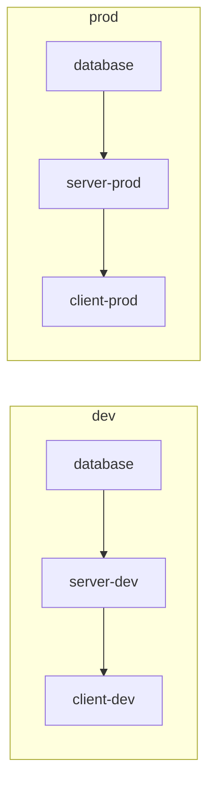

# Cài đặt

## Yêu cầu

- Docker và Docker Compose (cách nhanh nhất), hoặc
- Node.js 20.19 trở lên nếu chạy từng phần. CI dùng Node 26.
- Một khoá Gemini trong `AI_API_KEYS` nếu muốn dùng chatbot và embedding. Thiếu khoá thì phần còn lại vẫn chạy.

Kiểm tra nhanh:

```bash
docker --version
docker compose version
node -v
```

## Biến môi trường

Tạo file `.env` ở root từ mẫu:

```bash
cp .env.example .env
```

Windows PowerShell:

```powershell
Copy-Item .env.example .env
```

| Biến | Bắt buộc | Mặc định | Ý nghĩa |
|---|---|---|---|
| `DB_NAME` | Không | `food_ordering` | Tên database |
| `DB_USER` | Không | `postgres` | Tài khoản Postgres |
| `DB_PASSWORD` | Không | `postgres` | Mật khẩu Postgres |
| `DATABASE_URL` | Không | tự ghép từ `DB_*` | Compose tự đặt khi chạy container |
| `JWT_SECRET` | **Có** | không có | Tối thiểu 32 ký tự, thiếu thì server dừng |
| `JWT_EXPIRATION_MS` | Không | `86400000` | Hạn token, 1 ngày |
| `AI_API_KEYS` | Không | rỗng | Một khoá hoặc danh sách Gemini, phân tách dấu phẩy hoặc xuống dòng |
| `AI_MODELS` | Không | 3 model flash | Danh sách model chat, xoay khi lỗi |
| `EMBEDDING_MODELS` | Không | `gemini-embedding-2` | Model embedding, phải trả 768 chiều |
| `UPLOAD_DIR` | Không | `uploads` | Nơi lưu ảnh; compose đặt `/app/uploads` |
| `PORT` | Không | `8080` | Cổng API |
| `ORDER_PAYMENT_TIMEOUT_MINUTES` | Không | `30` | Số phút trước khi đơn QR chưa trả tiền bị huỷ |

Cấu hình được kiểm bằng zod ở `server/src/config/env.ts:18-35`. Sai hoặc thiếu biến bắt buộc thì server in danh sách lỗi rồi thoát, không chạy nửa vời (`server/src/config/env.ts:37-41`).

Server đọc `.env` theo thứ tự: root repo, rồi `server/.env`, rồi thư mục hiện tại (`server/src/config/env.ts:6-13`). Nhờ vậy chạy `npm run dev` trong `server/` vẫn thấy file `.env` ở root.

`.env` không được commit. `.gitignore` đã chặn.

## Chạy bằng Docker Compose

```bash
# Phát triển, có hot reload
docker compose --profile dev up --build

# Production hoặc demo
docker compose --profile prod up --build -d

# Drizzle Studio
docker compose --profile tools up -d
```



| Thành phần | Dev | Prod |
|---|---|---|
| Client | http://localhost:5173 | http://localhost |
| API | http://localhost:8080/api | http://localhost:8080/api |
| Database | localhost:5432 | localhost:5432 |
| Drizzle Studio | http://localhost:4983 | không có |

Service `database` không khai báo `profiles`, nên Postgres luôn chạy theo mọi profile và cả khi gọi `docker compose up` không profile (`docker-compose.yml:2-6`).

Hai điểm dễ nhầm:

- **Lần đầu chậm khoảng 30 giây là đúng.** `client-dev` chờ `server-dev` healthy, server chờ database healthy (`docker-compose.yml:72-74`). Trước đó client gọi vào cổng 8080 đã publish nhưng chưa có backend, nên trình duyệt báo `net::ERR_EMPTY_RESPONSE`. Đợi rồi tải lại.
- **Không thêm anonymous volume cho `node_modules`.** Comment ở `docker-compose.yml:56-58` giải thích: nó sẽ che `node_modules` của image, làm mất cả `drizzle-kit`.

## Kiểm tra đã chạy đúng

1. `curl http://localhost:8080/api/categories` trả mảng JSON, không phải lỗi.
2. Mở http://localhost:5173 thấy lưới món.
3. Đăng nhập `tuanpham@demo.com` / `tuanpham`, bấm dấu cộng trên một món, giỏ có món.
4. `curl http://localhost:8080/api/chatbot/status` trả `{"available":true}` nếu khoá AI hợp lệ.

## Chạy từng phần, không dùng Docker

Cần Postgres đang chạy ở `localhost:5432` với database khớp `.env`.

```bash
# Terminal 1
cd server
npm ci
npm run db:migrate
npm run db:seed
npm run dev
```

```bash
# Terminal 2
cd client
npm ci
npm run dev
```

Client lấy địa chỉ API từ `VITE_API_URL`, mặc định `http://localhost:8080/api` (`client/src/shared/api/http.ts:5-7`). `vite.config.ts` không có proxy `/api`, nên đổi cổng server phải đổi biến này.

## Dữ liệu mẫu

`server/src/db/seed.ts` tạo 10 tài khoản, 5 danh mục, 32 món (4 món ngừng phục vụ), 4 khuyến mãi, 15 đơn, 12 đánh giá và vài thông báo.

Seed **bỏ qua** nếu bảng `users` đã có dữ liệu (`server/src/db/seed.ts:26-36`). Vì vậy sửa dữ liệu mẫu không có tác dụng trên database cũ.

Mật khẩu demo bằng phần trước dấu `@`:

| Vai trò | Tên | Email | Mật khẩu |
|---|---|---|---|
| ADMIN | Nguyễn Hoàng Nam | namnguyen@demo.com | namnguyen |
| ADMIN | Trần Thu Hương | huongtran@demo.com | huongtran |
| CUSTOMER | Phạm Văn Tuấn | tuanpham@demo.com | tuanpham |
| CUSTOMER | Nguyễn Minh Khang | khangnguyen@demo.com | khangnguyen |
| CUSTOMER | Trần Phương Thảo | thaotran@demo.com | thaotran |
| CUSTOMER | Dương Ngọc Linh | linhduong@demo.com | linhduong |
| CUSTOMER | Nguyễn Thanh Sơn | sonnguyen@demo.com | sonnguyen |
| CUSTOMER | Đặng Quốc Trung | trungdang@demo.com | trungdang |
| CUSTOMER | Hoàng Minh Đức | duchoang@demo.com | duchoang |
| CUSTOMER | Hoàng Thanh Tùng | tunghoang@demo.com | tunghoang |

Reset toàn bộ:

```bash
docker compose --profile prod down -v
docker compose --profile prod up --build -d
```

`down -v` xoá cả database và ảnh đã tải lên. Chỉ dùng khi chấp nhận mất dữ liệu.

## Lệnh cơ sở dữ liệu

```bash
cd server
npm run db:generate   # tạo migration từ schema.ts
npm run db:migrate    # áp dụng migration
npm run db:seed       # nạp dữ liệu demo
npm run db:studio     # mở Drizzle Studio
```

Schema ở `server/src/db/schema.ts`, migration trong `server/drizzle/`, cấu hình ở `server/drizzle.config.ts`.

## Lỗi thường gặp khi cài

| Triệu chứng | Nguyên nhân | Cách sửa |
|---|---|---|
| `JWT_SECRET phai co it nhat 32 ky tu` rồi thoát | Thiếu hoặc quá ngắn | Điền chuỗi dài hơn 32 ký tự vào `.env` |
| `port is already allocated` ở 5432 | Máy đã có Postgres khác | Tắt Postgres local hoặc đổi cổng publish |
| Trình duyệt báo `ERR_EMPTY_RESPONSE` | Client chạy trước khi server sẵn sàng | Đợi khoảng 30 giây rồi tải lại |
| Đổi dữ liệu mẫu mà không thấy khác | Seed bị bỏ qua vì `users` đã có dòng | `down -v` rồi `up` lại |
| `relation "vector" does not exist` | Chưa chạy migration | `npm run db:migrate` |
| Chatbot `available: false` | `AI_API_KEYS` rỗng hoặc sai | Xem [Xử lý sự cố](Xu-ly-su-co) |
| Gọi API bị `Network Error` | Sai `VITE_API_URL` | Khớp cổng server, mặc định 8080 |

Tiếp theo: [Kiến trúc](Kien-truc) để hiểu code, hoặc [Luồng khách hàng](Luong-khach-hang) để đi theo một lượt mua.
