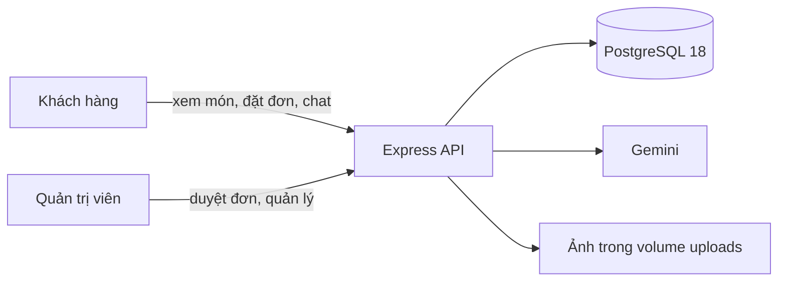

# FoodOrdering

Web đặt món cho một quán ăn, tích hợp trợ lý AI tư vấn món. Khách xem thực đơn, thêm món vào giỏ, đặt và thanh toán, theo dõi đơn, đánh giá món. Quản trị viên duyệt đơn, quản lý thực đơn, khuyến mãi, khách hàng và tài liệu tri thức cho chatbot.

Trang này là điểm vào. Mỗi trang còn lại trả lời một câu hỏi cụ thể và chỉ sang trang tiếp theo khi cần.

## Ba tác nhân



## Chạy thử trong 5 phút

```bash
cp .env.example .env
docker compose --profile dev up --build
```

- Client: http://localhost:5173
- API: http://localhost:8080/api
- Database: localhost:5432

Lần chạy đầu mất khoảng 30 giây vì client chờ server sẵn sàng. Chi tiết và cách xử lý lỗi ở [Cài đặt](Cai-dat).

## Đọc theo vai trò

| Bạn muốn | Đọc theo thứ tự |
|---|---|
| Chạy thử để demo hoặc báo cáo | [Cài đặt](Cai-dat) → [Luồng khách hàng](Luong-khach-hang) → [Đặt món và thanh toán](Luong-dat-mon) |
| Hiểu code trước khi sửa | [Kiến trúc](Kien-truc) → [Mô hình dữ liệu](Mo-hinh-du-lieu) → trang luồng tương ứng |
| Chỉ làm chatbot | [Luồng chatbot](Luong-chatbot) |
| Làm phần quản trị | [Luồng quản trị](Luong-quan-tri) → [API](API) |
| Kiểm tra hoặc triển khai | [Kiểm thử](Kiem-thu) → [Triển khai](Trien-khai) |
| Gặp lỗi khi chạy | [Xử lý sự cố](Xu-ly-su-co) |

## Bản đồ trang

| Trang | Trả lời câu hỏi |
|---|---|
| [Tổng quan](Tong-quan) | Hệ thống làm được gì, dùng công nghệ gì |
| [Cài đặt](Cai-dat) | Chạy ở máy mình thế nào |
| [Kiến trúc](Kien-truc) | Một request đi qua những đâu |
| [Mô hình dữ liệu](Mo-hinh-du-lieu) | Có bảng nào, quan hệ ra sao |
| [Luồng khách hàng](Luong-khach-hang) | Khách bấm gì thì chuyện gì xảy ra |
| [Đặt món và thanh toán](Luong-dat-mon) | Đơn được tạo, trả tiền và đổi trạng thái thế nào |
| [Luồng chatbot](Luong-chatbot) | Vì sao AI không bịa món |
| [Luồng quản trị](Luong-quan-tri) | Admin sửa được gì, bị chặn gì |
| [API](API) | Gọi endpoint nào, trả về gì |
| [Kiểm thử](Kiem-thu) | Chạy kiểm tra nào, phủ cái gì |
| [Triển khai](Trien-khai) | Đưa lên production thế nào |
| [Thuật ngữ](Thuat-ngu) | Quote, chunk, RAG, intent nghĩa là gì |
| [Xử lý sự cố](Xu-ly-su-co) | Lỗi này sửa ở đâu |

## Tài khoản demo

Mật khẩu bằng phần trước dấu `@` của email. Seed chỉ chạy khi bảng `users` còn trống.

| Vai trò | Email | Mật khẩu |
|---|---|---|
| ADMIN | namnguyen@demo.com | namnguyen |
| ADMIN | huongtran@demo.com | huongtran |
| Customer | tuanpham@demo.com | tuanpham |
| Customer | khangnguyen@demo.com | khangnguyen |

Danh sách đủ 10 tài khoản nằm trong [Cài đặt](Cai-dat).

## Cách đọc dẫn chứng code

Mọi khẳng định kỹ thuật đều kèm toạ độ dạng `server/src/user/order/service.ts:88-141`: file và khoảng dòng. Bấm vào là mở đúng đoạn trên GitHub.

Số dòng đối chiếu với code tại lần đăng wiki gần nhất. Commit nguồn nằm trong lịch sử của trang wiki (message dạng `Update wiki <sha>`). Trước mỗi lần đăng, `scripts/check-wiki-refs.mjs` kiểm lại toàn bộ toạ độ và chặn đăng nếu có chỗ trỏ sai.

Toạ độ đọc theo quy ước: `file:từ-dòng` hoặc `file:một-dòng`. Nếu chỉ có một số thì đó là dòng bắt đầu của hàm.
