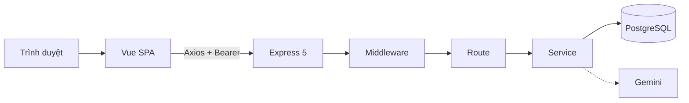
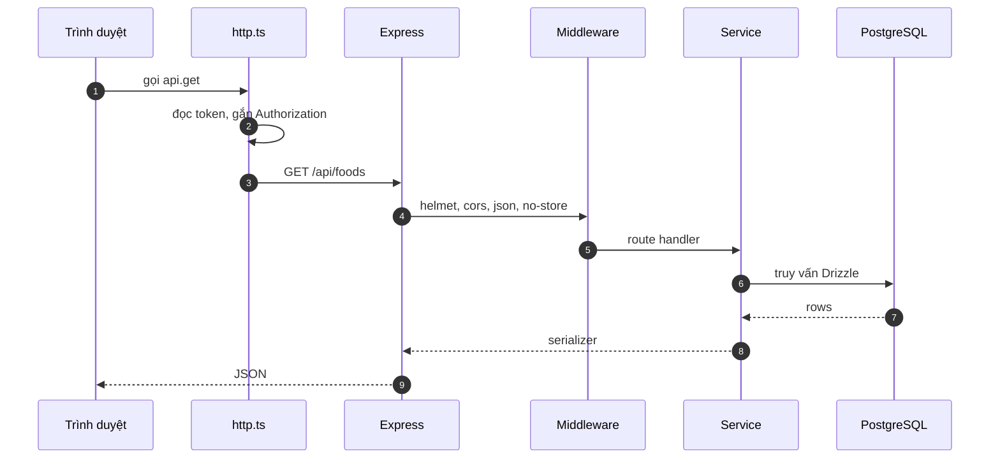
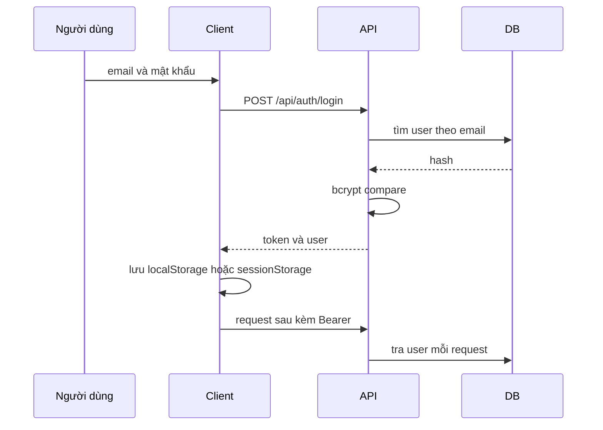

# Kiến trúc

Trang này đi theo một request từ trình duyệt tới database và quay lại, rồi giải thích các lớp dùng chung: xác thực, lỗi, tiền, thời gian.

## Sơ đồ tổng



## Vòng đời một request



Các mốc trong code:

1. `client/src/shared/api/http.ts:11-24` gắn `Authorization: Bearer <token>` nếu storage có token.
2. `server/src/app.ts:17-49` dựng app: tắt `x-powered-by`, bật helmet với `crossOriginResourcePolicy` cho ảnh, cors mở, `express.json` giới hạn 1 MB, và đặt `Cache-Control: no-store` cho mọi API.
3. `server/src/app.ts:34-43` gắn từng router. `/api/admin` gắn sau cùng và có middleware quyền riêng.
4. Mỗi module chia `routes.ts` (khai báo endpoint), `service.ts` (nghiệp vụ và truy vấn), `schema.ts` (zod).
5. `server/src/lib/serializers.ts` đổi bản ghi database sang JSON cho client: đổi `numeric` thành số, `Date` thành ISO, thêm `paymentDeadlineAt`.
6. Lỗi rơi vào `server/src/middleware/error.ts:9-43`, trả `{ message }` tiếng Việt.

## Client

SPA thuần, không SSR. Cấu trúc và quy ước:

```
client/src/
  user/          auth, menu, cart, order, payment, profile, review, notification, chatbot
  admin/         dashboard, menu, order, customer, promotion, report, chatbot
  shared/
    api/http.ts       Axios instance + hai interceptor
    api/message.ts    toast dùng chung, tối đa 3 cái cùng lúc
    types/index.ts    DTO, đồng bộ thủ công với server
    utils/            format tiền ngày, trạng thái đơn, validator
    stores/uiStore.ts drawer giỏ, drawer thông báo, trạng thái chatbot
  layouts/       DefaultLayout.vue cho khách, AdminLayout.vue cho quản trị
  router/index.ts
  composables/   useCartQuote.ts, useHasBottomBar.ts
```

Quy ước:

- Mỗi module có `api.ts` gọi endpoint và `store.ts` nếu cần state dùng chung. Component không gọi `http` trực tiếp.
- Toast lấy từ `client/src/shared/api/message.ts`, không dùng `useMessage()`.
- Sửa DTO server thì sửa luôn `client/src/shared/types/index.ts`; không có sinh kiểu tự động.
- Nút bấm dùng `NButton` của Naive UI, không viết wrapper riêng.

Route guard chỉ là UX:

```ts
// client/src/router/index.ts:78-91
if (to.meta.requiresAdmin && user?.role !== 'ADMIN') {
  return user ? { path: '/' } : { path: '/login', state: { from: { pathname: to.path, search: '' } } }
}
```

Người dùng sửa được guard bằng cách gọi thẳng API, nên quyền thật nằm ở middleware.

## Server

```
server/src/
  user/          module khách hàng
  admin/         module quản trị
  middleware/    auth.ts, error.ts, rateLimit.ts
  lib/           db, jwt, password, provider, serializers, businessTime, text-normalizer
  config/env.ts
  db/            schema.ts, seed.ts
  user/pricing/  service.ts và engine.ts, nơi duy nhất tính tiền
  app.ts
  server.ts
```

Luồng phụ thuộc một chiều: `routes` gọi `service`, `service` gọi `lib` và `db`. `lib` không import ngược lên `user` hay `admin`, trừ `serializers.ts` đọc `paymentDeadlineAt` của order.

## Xác thực và phân quyền



- Mật khẩu băm bcrypt, so sánh trong `server/src/user/auth/service.ts:45-80`.
- Token HS256, subject là email, claim `role`, sinh ở `server/src/lib/jwt.ts:6-11`.
- `server/src/middleware/auth.ts:16-27` xác thực chữ ký rồi **tra database mỗi request**. Nhờ vậy tài khoản bị khoá mất quyền ngay.
- `requireAuth` (`auth.ts:29-34`) bắt buộc đăng nhập, `optionalAuth` (`auth.ts:37-40`) chỉ gắn người dùng nếu token hợp lệ, `requireRole` (`auth.ts:42-49`) kiểm vai trò.
- Client lưu token ở `localStorage` hoặc `sessionStorage`. Ô "Ghi nhớ đăng nhập" chỉ quyết định lưu ở đâu và ghi nhớ email, không lưu mật khẩu và không kéo dài hạn token.
- Gặp 401, interceptor xoá phiên rồi đưa về `/login` (`client/src/shared/api/http.ts:26-37`).

## Mã lỗi

| Mã | Khi nào | Nơi phát |
|---|---|---|
| 400 | dữ liệu sai, chuyển trạng thái sai, món ngừng bán | `badRequest` trong `server/src/lib/errors.ts:11` |
| 401 | thiếu hoặc sai token | `server/src/middleware/auth.ts:31`, `:45` |
| 403 | sai vai trò, không phải chủ đơn hoặc chủ đánh giá | `server/src/middleware/auth.ts:46`, `server/src/user/order/service.ts:249-251` |
| 404 | không thấy tài nguyên | `notFound` trong `server/src/lib/errors.ts:14` |
| 409 | trùng khoá duy nhất hoặc vi phạm khoá ngoại | `server/src/middleware/error.ts:18-29` |
| 429 | AI bị giới hạn tần suất | `server/src/user/chatbot/reply.ts:79` |
| 500 | lỗi không lường trước | `server/src/middleware/error.ts:41-42` |
| 502 | AI lỗi 5xx, timeout hoặc trả JSON hỏng | `server/src/user/chatbot/reply.ts:80-91` |
| 503 | chưa cấu hình khoá AI | `server/src/user/chatbot/service.ts:76` |

Chi tiết cách server dựng lỗi: `HttpError` giữ mã và message (`server/src/lib/errors.ts:1-9`), bốn helper `badRequest`/`unauthorized`/`forbidden`/`notFound` chỉ là cách viết ngắn.

## Tiền

Chỉ một nơi tính tiền: `server/src/user/pricing/`.

- `priceOrder` (`server/src/user/pricing/service.ts:61-115`) đọc giá từ `foods`, tính tổng đơn, rồi chọn khuyến mãi.
- `buildRules` (`service.ts:45-59`) lọc khuyến mãi còn hiệu lực và đủ hạn mức.
- `engine.ts` chứa logic thuần: chọn khuyến mãi tốt nhất cho một dòng, tính số tiền giảm.
- `markUsed` (`service.ts:163-179`) tăng `used_count` bằng một câu update có điều kiện, để không vượt `usage_limit` khi hai đơn tới cùng lúc.

Client không nhân phần trăm và không trừ khuyến mãi. `client/src/composables/useCartQuote.ts:13-50` gọi `POST /api/cart/quote` sau 250 ms, huỷ request cũ, và chỉ hiển thị lại kết quả.

Hai vòng trong `priceOrder` là cố ý: vòng một cộng tổng để biết đơn có đạt `min_order_total` không, vòng hai mới chọn khuyến mãi. Gộp thành một vòng sẽ áp sai khuyến mãi có hạn mức.

## Ngày giờ

`server/src/lib/businessTime.ts` xử lý múi giờ Việt Nam, không phụ thuộc múi giờ máy chủ hay máy khách.

- `businessTimeParts` (`businessTime.ts:29-42`) trả ngày lịch, thứ và số phút trong ngày theo `Asia/Ho_Chi_Minh`.
- `parseBusinessDate` (`businessTime.ts:56-73`) đọc `"YYYY-MM-DD"` thành đầu hoặc cuối ngày giờ Việt; chuỗi ISO giữ nguyên instant.
- Hàm kiểm tra lại `dayKey` sau khi tạo `Date`, vì V8 tự cuộn ngày sai như `2026-02-31` thành tháng 3 (`businessTime.ts:64-67`).

## Cơ sở dữ liệu và DTO

Bảng và quan hệ ở [Mô hình dữ liệu](Mo-hinh-du-lieu). Hai điều cần nhớ khi sửa:

1. Kiểu trong `client/src/shared/types/index.ts` phải sửa cùng lúc với DTO server, nếu không TypeScript vẫn qua nhưng runtime lệch.
2. `numeric` của Postgres về JS là chuỗi. Ra khỏi service phải qua serializer để thành số, nếu không client cộng chuỗi và ra `"1000"+"2000"`.

Tiếp theo: [Mô hình dữ liệu](Mo-hinh-du-lieu) hoặc đi thẳng vào [Luồng khách hàng](Luong-khach-hang).
