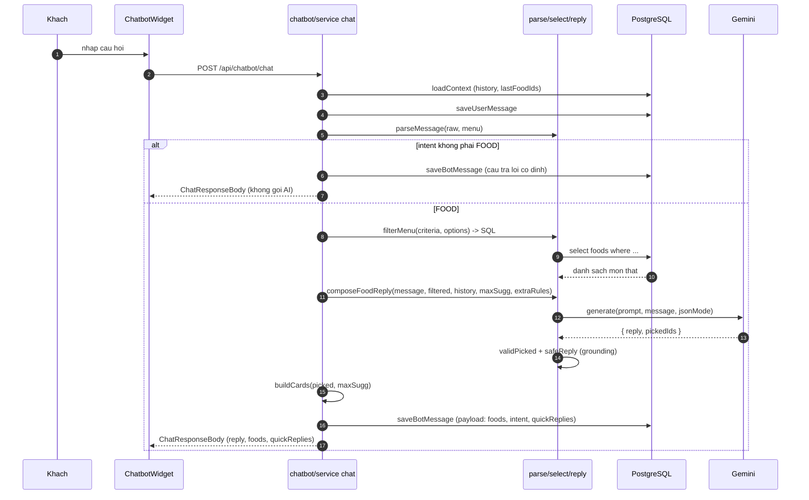
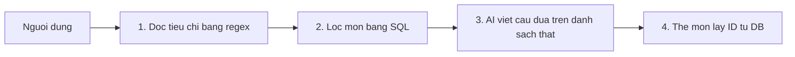

# Luong chatbot

Trang nay giai thich vi sao tro ly AI khong bia mon hoac gia, va cach tai lieu tri thuc cua quan duoc dung.

## Trai nghiem tren man hinh

- Widget chat mo bang `uiStore.chatOpen`, khong phai state cuc bo, nen hero va empty state cung mo duoc.
- Chi khach `CUSTOMER` dung duoc lich su; admin va khach vang lai thay nut "Dang nhap".
- Khi cho phan hoi, client vong qua cac trang thai "Dang phan tich..." -> "Dang tra cuu..." -> "Dang soan cau tra loi..." khoang 600 ms moi buoc; phan hoi toi thieu 2 giay.
- Chi tin bot moi nhat giu the mon (toi da 5); tin cu mat the.
- Khung tu cuon khi dang o day (cach day <= 64 px); cuon len thi hien nut "Tin moi nhat".

## So do tuan tu: mot luot chat goi y mon



## Bon buoc chong AI bia



1. `parseMessage` (`server/src/user/chatbot/parse.ts:82`) doc rang buoc tu cau.
2. `filterMenu` (`server/src/user/chatbot/select.ts:22`) dung dieu kien Drizzle va truy van SQL.
3. `composeFoodReply` (`server/src/user/chatbot/reply.ts:51`) goi AI voi `jsonMode`, chi gui ten, gia, loai cua toi da 10 mon.
4. `buildCards` (`server/src/user/chatbot/select.ts:93`) cat the theo `max_suggestions` va lay ID/gia tu DB.

AI khong bao gio tu nghi ra mon hoac gia. Prompt chi nhan danh sach mon server da loc.

## Cong y dinh

`normalizeChat` doi teencode phu dinh ("ko/k/hok/hem" -> "khong", "100 k" -> "100k") truoc khi doc regex. Cau khong co tin hieu mon an (`hasFoodSignal`) va khong co rang buoc nao, hoac go lung tung (`looksLikeGibberish`, cum phu am >= 5) tra cau tu choi co dinh, `intent = OUT_OF_SCOPE`, khong goi AI va khong tra the mon.

`parseMessage` (`parse.ts:82`) tra ve `ParsedQuery` gom `intent`, `criteria`, `more`, `onlyLast`, `gibberish`.

### Code: doc y dinh va rang buoc

Toa do: `server/src/user/chatbot/parse.ts:56-121`.

Vao: cau hoi goc + danh sach ten mon. Ra: `ParsedQuery`.

```ts
export function parseMessage(raw: string, menu: DishName[]): ParsedQuery {
  const text = normalizeChat(raw);
  const p = plain(text);
  // Nhanh chao/cam on/huong dan.
  if (["xin chao", "chao", "hello", "hi"].some((g) => p === g || p.startsWith(`${g} `))) {
    return { text, p, intent: "GREETING", criteria: emptyCriteria(), more: false, onlyLast: false, gibberish: false };
  }
  if (["cam on", "thank", "thanks", "tam biet", "bye"].some((k) => p === k || p.startsWith(`${k} `))) {
    return { text, p, intent: "THANKS", criteria: emptyCriteria(), more: false, onlyLast: false, gibberish: false };
  }

  const regex = readConstraints(raw, menu); // regex doc budget, people, spicy, diet, exclude, groups, dishIds
  const hasConstraints = regex.budgetTotal != null || regex.people != null || regex.spicyMax != null
    || regex.spicyRequired || regex.exclude.length > 0
    || regex.diets.length > 0 || regex.groups.length > 0 || regex.dishIds.length > 0;

  const gib = looksLikeGibberish(p);
  if (gib || (!hasFoodSignal(p) && !hasConstraints)) {
    return { text, p, intent: "OUT_OF_SCOPE", criteria: regex, more: false, onlyLast: false, gibberish: gib };
  }

  return {
    text, p, intent: "FOOD", criteria: regex,
    more: wantsMoreDishes(p),        // "mon khac", "goi y them"
    onlyLast: refersToLastPicks(p),  // "mon do", "may mon tren"
    gibberish: false,
  };
}
```

Vi sao: co gang doc regex truoc; neu khong co tin hieu mon an va khong co rang buoc nao thi tu choi, tranh goi AI cho cau hoi ngoai pham vi.

## Cach ap tieu chi

Regex doc: `budget`, `people`, `spicyMax`, `spicyRequired`, `diets`, `exclude`, `groups`, `dishIds`. Criteria rong khop moi mon, nen phai co cong y dinh o tren de khong tra ca phe da cho cau "mon chay".

Loc SQL trong `filterMenu` (`select.ts:22-91`):

1. Chi mon `available`.
2. `lastFoodIds`: loai ("mon khac" -> `NOT IN`) hoac gioi han ("mon do" -> `IN`).
3. Loc `spicyMax`, `spicyRequired`, nhan che do an, thanh phan loai tru. `spicyMax = 0` chan them ten/nguyen lieu chua "ot" vi du lieu `spicyLevel` co the sai (`select.ts:36-39`).
4. Ngan sach la **tong** cua ca nhom, nen moi mon bi chan o `floor(budget / people)` (`select.ts:16-20`).
5. Ket qua toi da 40 dong, sap theo gia tang dan va uu tien mon chinh (`select.ts:60`, `:64-78`).

The tra ve toi da 5 (`buildCards`, `select.ts:93-100`), theo `ai_setting.max_suggestions` kep 1..5 (`service.ts:31-39`).

### Code: loc mon bang SQL

Toa do: `server/src/user/chatbot/select.ts:22-91`.

Vao: `Criteria` + options (lastFoodIds, excludeIds, restrictToLast, restrictIds). Ra: danh sach `FoodWithCategory[]`.

```ts
export const filterMenu = async (criteria, options) => {
  const whereConditions = [eq(foods.available, true)];

  if (options.restrictToLast && options.lastFoodIds?.length) {
    whereConditions.push(inArray(foods.id, options.lastFoodIds)); // "mon do" -> IN
  }
  if (options.excludeIds?.length) {
    whereConditions.push(notInArray(foods.id, options.excludeIds)); // "mon khac" -> NOT IN
  }
  if (criteria.spicyMax != null) whereConditions.push(lte(foods.spicyLevel, criteria.spicyMax));
  if (criteria.spicyRequired) whereConditions.push(gt(foods.spicyLevel, 0));
  if (criteria.spicyMax === 0) {
    whereConditions.push(sql`${foods.name} NOT ILIKE ${"%?t%"}`);
    whereConditions.push(sql`${foods.ingredients} NOT ILIKE ${"%?t%"}`);
  }
  const cap = perDishCap(criteria); // floor(budget / people)
  if (cap != null) whereConditions.push(sql`${foods.price}::numeric <= ${cap}`);
  if (criteria.exclude?.length) {
    for (const a of criteria.exclude) {
      whereConditions.push(sql`${foods.allergens} NOT ILIKE ${"%" + a + "%"}`);
      whereConditions.push(sql`${foods.ingredients} NOT ILIKE ${"%" + a + "%"}`);
    }
  }
  if (criteria.diets?.length) {
    for (const d of criteria.diets) {
      whereConditions.push(sql`${foods.dietaryTags} ILIKE ${"%" + d + "%"}`);
    }
  }

  const rows = await db.query.foods.findMany({
    where: and(...whereConditions),
    with: { category: true },
    orderBy: [asc(foods.price)],
    limit: 40,
  });

  let result = rows.filter((f) => f.available);
  // Uu tien mon chinh, bo do uong/trang mieng neu khong yeu cau.
  const wantsMain = criteria.groups.some((g) => plain(g).includes("mon chinh") || plain(g).includes("mon man"));
  const wantsDrink = asksForDrinkOrDessert(criteria);
  if (!wantsDrink || wantsMain) {
    const mains = result.filter((f) => !DRINK_DESSERT_SLUGS.has(f.category?.slug ?? ""));
    if (mains.length > 0) result = mains;
  }
  return result.slice(0, 40);
};
```

Vi sao: toan bo loc chay bang SQL, khong chấm điểm; `spicyMax = 0` chan them "ot" vi du lieu `spicyLevel` co the sai.

## Khi AI loi

- `chat()` nem 503 truoc khi luu cau hoi hay chon mon neu `!isConfigured()` (`service.ts:76`).
- AI loi 5xx/timeout/JSON hong thi `composeFoodReply` nem 502 (`reply.ts:79-92`).
- Bi rate limit thi nem 429 (`reply.ts:79`).
- Cau tra loi dung template an toan khi AI tra ngon ngu lech (`hasForeignScript`, `grounding.ts:4-6`).
- `dropTrailingQuestion` bo cau hoi cuoi, `limitSentences` cat con 3 cau (`grounding.ts:8-19`).

### Code: goi AI va kiem ket qua

Toa do: `server/src/user/chatbot/reply.ts:51-97`.

Vao: `message`, `candidates`, `history`, `maxSugg`, `extraRules`. Ra: `{ reply, picked }`.

```ts
export const composeFoodReply = async (message, candidates, history, maxSugg, extraRules) => {
  const menuText = candidates
    .map((f) => `${f.id}|${f.name} - ${Number(f.price).toLocaleString("vi-VN")}d - ${f.category?.name ?? "mon"} - cay ${f.spicyLevel}`)
    .join("\n");
  const prompt = CHAT_PROMPT
    .replace("%s", menuText || "(trong)")
    .replace("%s", "(khong co)")
    .replace("%d", String(maxSugg))
    .replace("%s", history.join("\n") || "(khong co)")
    .replace("%s", "")
    .replace("%s", extraRules || "(khong co)");

  let raw: string;
  try {
    raw = await provider.generate(prompt, message, true, {
      timeoutMs: provider.AI_TIMEOUTS.reply,
      maxOutputTokens: provider.AI_MAX_OUTPUT_TOKENS,
    });
  } catch (e) {
    if (e instanceof provider.AiRateLimitedException) throw new HttpError(429, "Qua nhieu yeu cau, vui long thu lai sau it phut.");
    throw new HttpError(502, "Tro ly AI dang gap su co, vui long thu lai sau it phut.");
  }

  const cleaned = raw.replaceAll("```json", "").replaceAll("```", "").trim();
  const jsonMatch = cleaned.match(/\{[\s\S]*\}/);
  let parsedJson: { reply?: string; pickedIds?: unknown };
  try {
    parsedJson = JSON.parse(jsonMatch ? jsonMatch[0] : cleaned);
  } catch {
    throw new HttpError(502, "Tro ly AI chua tra loi duoc, vui long thu lai.");
  }
  const picked = validPicked(parsedJson.pickedIds, candidates, maxSugg); // chi giu ID nam trong candidates
  const reply = safeReply(String(parsedJson.reply ?? ""), picked);
  return { reply, picked };
};
```

Tung buoc:
- `reply.ts:58-70`: lap prompt tu danh sach mon that (toi da 10 mon).
- `reply.ts:72-82`: goi AI voi `jsonMode`; loi 429/502 theo loai loi.
- `reply.ts:84-92`: parse JSON, lay `pickedIds`.
- `reply.ts:94`: `validPicked` loai bo ID khong nam trong candidates (chong AI bia mon).
- `reply.ts:95`: `safeReply` don cau tra loi, dung template neu ngon ngu lech.

Vi sao: the mon lay tu `validPicked` (ID trong candidates), khong tin text AI.

### Code: don cau tra loi

Toa do: `server/src/user/chatbot/grounding.ts:1-19`.

```ts
export function hasForeignScript(reply: string): boolean {
  return /[\u0400-\u04FF\u0590-\u05FF\u0600-\u06FF\u0900-\u097F\u0E00-\u0E7F\u3040-\u30FF\u4E00-\u9FFF]/.test(reply);
}

export function dropTrailingQuestion(reply: string): string {
  const parts = reply.split(/(?<=[.!?])\s+/).map((s) => s.trim()).filter(Boolean);
  while (parts.length > 1 && parts[parts.length - 1]!.endsWith("?")) parts.pop();
  return parts.join(" ");
}

export function limitSentences(reply: string, max = 3): string {
  const parts = reply.split(/(?<=[.!?])\s+/).map((s) => s.trim()).filter(Boolean);
  const kept = parts.slice(0, max).join(" ");
  return /[.!?]$/.test(kept) ? kept : `${kept}.`;
}
```

Vi sao: chan AI tra ngon ngu khac (template thay the); bo cau hoi cuoi va gioi han 3 cau.

## RAG tai lieu quan

Chi khi provider dung duoc:

- Upload, parse, chunk **khong goi AI**, luon chay. Chunk v2: tach theo doan, giu tieu de, overlap 80 ky tu, khong cat giua tu (`documentParser.ts:27-99`).
- Embed chunk chi khi `isConfigured()` = true; thieu khoa hoac provider loi thi chunk van luu, thieu vector.
- Retrieval: `searchChunks` nhung cau hoi, cosine top 5, nguong 0.55, chi tai lieu `enabled` (`retrieval.ts:14-66`). Thieu vector -> rong.
- Tra loi: `composeInfoReply` ghep bullet trich chunk (cat 400 ky tu) kem `citations`, khong goi AI luot 2 (`reply.ts:99-106`). Rong -> "Minh chua co thong tin xac thuc...".
- Bo hoan toan tsvector va `keywordSearchKnowledge`. Khong con fallback keyword.

Model embedding: 768 chieu, chon theo `EMBEDDING_MODELS`. Cot `vector(768)` va HNSW index `vector_cosine_ops` (`server/src/db/schema.ts:245-257`).

## Cau hoi tiep

`history` (3 cau gan nhat) va `lastFoodIds` (mon o tin bot gan nhat) doc o server (`loadContext`, `service.ts:41-55`), khong can client gui kem.

- `wantsMoreDishes` ("mon khac", "goi y them") loai dung cac mon do bang `NOT IN`.
- `refersToLastPicks` ("mon do", "may mon tren") chi xet trong `lastFoodIds` bang `IN`.
- Dai tu tham chieu duoc loai truoc khi loc ILIKE, neu khong danh sach ra rong.
- Khong dung do dai cau de doan hoi tiep.

## Lich su hoi thoai

Moi tai khoan co lich su rieng:

- `GET/DELETE /api/chatbot/sessions/**` yeu cau dang nhap.
- `listSessions`/`getLatestSession`/`getSession`/`deleteSession` trong `user/chatbot/service.ts`.
- Tin BOT luu kem `chat_messages.payload` (jsonb) gom `foods`/`intent`/`citations`/`quickReplies`, nen mo lai phien van con the mon.
- Gia trong the la gia luc tra loi; them vao gio/dat don van lay gia hien tai tu DB.
- Danh sach tra toi da 20 phien moi nhat, tieu de lay tu cau hoi USER dau tien (`sessions.ts` `sessionTitle`, cat 60 ky tu).
- Phien cua nguoi khac tra 404 nhu phien khong ton tai.

Client (`useChatConversation.ts`) goi `GET /api/chatbot/sessions/latest` khi mount (chi voi CUSTOMER) de khoi phuc phien moi nhat tu server; khong con cache `localStorage`. `requestEpoch` tang moi lan `resetChat`/`applyHistory` de phan hoi dang bay cua phien cu bi bo.

## Thieu hoac hong khoa AI

`lib/provider.ts` `isConfigured()` false khi khong co khoa nao con song (`provider.ts:141`).

- `GET /api/chatbot/status` goi `verifyKey()` va probe song song cac model; `available = false` chi khi **moi** model deu bao loi ro rang (503/404), con mot model cham (timeout) hay chet rieng le van tinh la dung duoc. Ket qua false giu 60s, true giu 5 phut (`provider.ts:15-16`).
- `chat()` nem 503 truoc khi luu cau hoi hay chon mon (`service.ts:76`).
- status tra `available = false` de client khoa o nhap, hien banner.
- RAG tra "Minh chua co thong tin xac thuc ve muc nay trong tai lieu cua quan."
- Embedding khong chay, chunk van luu nhung thieu vector.
- Nhanh khong goi AI (chao, cam on, huong dan dat mon, cau ngoai pham vi) van chay binh thuong.

## Provider AI

`server/src/lib/provider.ts` la lop duy nhat goi API AI (`generate` voi `jsonMode`) va sinh vector embedding (`embed`, `embedBatch`).

- Chi ho tro Gemini (`@google/genai`).
- Khoa doc tu `AI_API_KEYS`, model chat tu `AI_MODELS`, model embedding tu `EMBEDDING_MODELS`; ca ba nhan mot gia tri hoac danh sach phan tach dau phay/xuong dong.
- Tu xoay khoa khi mot khoa bi 429 va loai khoa bi tu choi (401/403 hoac `API_KEY_INVALID`) toi khi khoi dong lai server.
- Danh sach model mac dinh `gemini-3.1-flash-lite,gemini-3.5-flash-lite,gemini-3.6-flash`; gap 503/404/timeout thi xoay model ke tiep, model 404 bi loai toi khi restart, model 503/timeout nghi 60s.
- Vector 768 chieu (`EMBEDDING_DIM`).
- Retry toi da 2 lan cho 5xx (delay 600 ms roi 1800 ms), khoa 25s sau mot 429 that va xoay khoa khac, deadline tong 45s (`provider.ts:8-22`).
- Timeout rieng theo buoc (`AI_TIMEOUTS.reply` 20s, `embed` 8s); `thinkingBudget: 0` gui cho moi model chat, model nao tra 400 thi bo co va ghi nho theo model.
- Prompt tra loi chi gui ten/gia/loai cua toi da 10 mon.

Tiep theo: [Luong quan tri](Luong-quan-tri) hoac [API](API).
