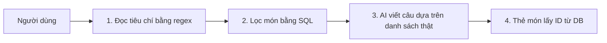

# Luồng chatbot

Trang này giải thích vì sao trợ lý AI không bịa món hoặc giá, và cách tài liệu tri thức của quán được dùng.

## Trải nghiệm trên màn hình

- Widget chat mở bằng `uiStore.chatOpen`, không phải state cục bộ, nên hero và empty state cũng mở được.
- Chỉ khách `CUSTOMER` dùng được lịch sử; admin và khách vãng lai thấy nút "Đăng nhập".
- Khi chờ phản hồi, client vòng qua các trạng thái "Đang phân tích..." → "Đang tra cứu..." → "Đang soạn câu trả lời..." khoảng 600 ms mỗi bước; phản hồi tối thiểu 2 giây.
- Chỉ tin bot mới nhất giữ thẻ món (tối đa 5); tin cũ mất thẻ.
- Khung tự cuộn khi đang ở đáy (cách đáy ≤ 64 px); cuộn lên thì hiện nút "Tin mới nhất".

## Sơ đồ tuần tự: một lượt chat gợi ý món


## Bốn bước chống AI bịa



1. `parseMessage` (`server/src/user/chatbot/parse.ts:82`) đọc ràng buộc từ câu.
2. `filterMenu` (`server/src/user/chatbot/select.ts:22`) dựng điều kiện Drizzle và truy vấn SQL.
3. `composeFoodReply` (`server/src/user/chatbot/reply.ts:51`) gọi AI với `jsonMode`, chỉ gửi tên, giá, loại của tối đa 10 món.
4. `buildCards` (`server/src/user/chatbot/select.ts:93`) cắt thẻ theo `max_suggestions` và lấy ID/giá từ DB.

AI không bao giờ tự nghĩ ra món hoặc giá. Prompt chỉ nhận danh sách món server đã lọc.

## Cổng ý định

`normalizeChat` đổi teencode phủ định ("ko/k/hok/hem" → "không", "100 k" → "100k") trước khi đọc regex. Câu không có tín hiệu món ăn (`hasFoodSignal`) và không có ràng buộc nào, hoặc gõ lung tung (`looksLikeGibberish`, cụm phụ âm ≥ 5) trả câu từ chối cố định, `intent = OUT_OF_SCOPE`, không gọi AI và không trả thẻ món.

`parseMessage` (`parse.ts:82`) trả về `ParsedQuery` gồm `intent`, `criteria`, `more`, `onlyLast`, `gibberish`.

### Code: đọc ý định và ràng buộc

Tọa độ: `server/src/user/chatbot/parse.ts:56-121`.

Vào: câu hỏi gốc + danh sách tên món. Ra: `ParsedQuery`.

```ts
export function parseMessage(raw: string, menu: DishName[]): ParsedQuery {
  const text = normalizeChat(raw);
  const p = plain(text);
  // Nhanh chao/cam on/huong dan.
  if (["xin chao", "chao", "hello", "hi"].some((g) => p === g || p.startsWith(`${g} `))) {
    return { text, p, intent: "GREETING", criteria: emptyCriteria(), more: false, onlyLast: false, gibberish: false };
  }
  if (["cam on", "thank", "thanks", "tam biet", "bye"].some((k) => p === k || p.startsWith(`${k} `))) {
    return { text, p, intent: "THANKS", criteria: emptyCriteria(), more: false, onlyLast: false, gibberish: false };
  }

  const regex = readConstraints(raw, menu); // regex doc budget, people, spicy, diet, exclude, groups, dishIds
  const hasConstraints = regex.budgetTotal != null || regex.people != null || regex.spicyMax != null
    || regex.spicyRequired || regex.exclude.length > 0
    || regex.diets.length > 0 || regex.groups.length > 0 || regex.dishIds.length > 0;

  const gib = looksLikeGibberish(p);
  if (gib || (!hasFoodSignal(p) && !hasConstraints)) {
    return { text, p, intent: "OUT_OF_SCOPE", criteria: regex, more: false, onlyLast: false, gibberish: gib };
  }

  return {
    text, p, intent: "FOOD", criteria: regex,
    more: wantsMoreDishes(p),        // "mon khac", "goi y them"
    onlyLast: refersToLastPicks(p),  // "mon do", "may mon tren"
    gibberish: false,
  };
}
```

Vì sao: cố gắng đọc regex trước; nếu không có tín hiệu món ăn và không có ràng buộc nào thì từ chối, tránh gọi AI cho câu hỏi ngoài phạm vi.

## Cách áp tiêu chí

Regex đọc: `budget`, `people`, `spicyMax`, `spicyRequired`, `diets`, `exclude`, `groups`, `dishIds`. Criteria rỗng khớp mọi món, nên phải có cổng ý định ở trên để không trả cà phê đá cho câu "món chay".

Lọc SQL trong `filterMenu` (`select.ts:22-91`):

1. Chỉ món `available`.
2. `lastFoodIds`: loại ("món khác" → `NOT IN`) hoặc giới hạn ("món đó" → `IN`).
3. Lọc `spicyMax`, `spicyRequired`, nhãn chế độ ăn, thành phần loại trừ. `spicyMax = 0` chặn thêm tên/nguyên liệu chứa "ớt" vì dữ liệu `spicyLevel` có thể sai (`select.ts:36-39`).
4. Ngân sách là **tổng** của cả nhóm, nên mỗi món bị chặn ở `floor(budget / people)` (`select.ts:16-20`).
5. Kết quả tối đa 40 dòng, sắp theo giá tăng dần và ưu tiên món chính (`select.ts:60`, `:64-78`).

Thẻ trả về tối đa 5 (`buildCards`, `select.ts:93-100`), theo `ai_setting.max_suggestions` kẹp 1..5 (`service.ts:31-39`).

### Code: lọc món bằng SQL

Tọa độ: `server/src/user/chatbot/select.ts:22-91`.

Vào: `Criteria` + options (lastFoodIds, excludeIds, restrictToLast, restrictIds). Ra: danh sách `FoodWithCategory[]`.

```ts
export const filterMenu = async (criteria, options) => {
  const whereConditions = [eq(foods.available, true)];

  if (options.restrictToLast && options.lastFoodIds?.length) {
    whereConditions.push(inArray(foods.id, options.lastFoodIds)); // "mon do" -> IN
  }
  if (options.excludeIds?.length) {
    whereConditions.push(notInArray(foods.id, options.excludeIds)); // "mon khac" -> NOT IN
  }
  if (criteria.spicyMax != null) whereConditions.push(lte(foods.spicyLevel, criteria.spicyMax));
  if (criteria.spicyRequired) whereConditions.push(gt(foods.spicyLevel, 0));
  if (criteria.spicyMax === 0) {
    whereConditions.push(sql`${foods.name} NOT ILIKE ${"%?t%"}`);
    whereConditions.push(sql`${foods.ingredients} NOT ILIKE ${"%?t%"}`);
  }
  const cap = perDishCap(criteria); // floor(budget / people)
  if (cap != null) whereConditions.push(sql`${foods.price}::numeric <= ${cap}`);
  if (criteria.exclude?.length) {
    for (const a of criteria.exclude) {
      whereConditions.push(sql`${foods.allergens} NOT ILIKE ${"%" + a + "%"}`);
      whereConditions.push(sql`${foods.ingredients} NOT ILIKE ${"%" + a + "%"}`);
    }
  }
  if (criteria.diets?.length) {
    for (const d of criteria.diets) {
      whereConditions.push(sql`${foods.dietaryTags} ILIKE ${"%" + d + "%"}`);
    }
  }

  const rows = await db.query.foods.findMany({
    where: and(...whereConditions),
    with: { category: true },
    orderBy: [asc(foods.price)],
    limit: 40,
  });

  let result = rows.filter((f) => f.available);
  // Uu tien mon chinh, bo do uong/trang mieng neu khong yeu cau.
  const wantsMain = criteria.groups.some((g) => plain(g).includes("mon chinh") || plain(g).includes("mon man"));
  const wantsDrink = asksForDrinkOrDessert(criteria);
  if (!wantsDrink || wantsMain) {
    const mains = result.filter((f) => !DRINK_DESSERT_SLUGS.has(f.category?.slug ?? ""));
    if (mains.length > 0) result = mains;
  }
  return result.slice(0, 40);
};
```

Vì sao: toàn bộ lọc chạy bằng SQL, không chấm điểm; `spicyMax = 0` chặn thêm "ớt" vì dữ liệu `spicyLevel` có thể sai.

## Khi AI lỗi

- `chat()` ném 503 trước khi lưu câu hỏi hay chọn món nếu `!isConfigured()` (`service.ts:76`).
- AI lỗi 5xx/timeout/JSON hỏng thì `composeFoodReply` ném 502 (`reply.ts:79-92`).
- Bị rate limit thì ném 429 (`reply.ts:79`).
- Câu trả lời dùng template an toàn khi AI trả ngôn ngữ lệch (`hasForeignScript`, `grounding.ts:4-6`).
- `dropTrailingQuestion` bỏ câu hỏi cuối, `limitSentences` cắt còn 3 câu (`grounding.ts:8-19`).

### Code: gọi AI và kiểm kết quả

Tọa độ: `server/src/user/chatbot/reply.ts:51-97`.

Vào: `message`, `candidates`, `history`, `maxSugg`, `extraRules`. Ra: `{ reply, picked }`.

```ts
export const composeFoodReply = async (message, candidates, history, maxSugg, extraRules) => {
  const menuText = candidates
    .map((f) => `${f.id}|${f.name} - ${Number(f.price).toLocaleString("vi-VN")}d - ${f.category?.name ?? "mon"} - cay ${f.spicyLevel}`)
    .join("\n");
  const prompt = CHAT_PROMPT
    .replace("%s", menuText || "(trong)")
    .replace("%s", "(khong co)")
    .replace("%d", String(maxSugg))
    .replace("%s", history.join("\n") || "(khong co)")
    .replace("%s", "")
    .replace("%s", extraRules || "(khong co)");

  let raw: string;
  try {
    raw = await provider.generate(prompt, message, true, {
      timeoutMs: provider.AI_TIMEOUTS.reply,
      maxOutputTokens: provider.AI_MAX_OUTPUT_TOKENS,
    });
  } catch (e) {
    if (e instanceof provider.AiRateLimitedException) throw new HttpError(429, "Qua nhieu yeu cau, vui long thu lai sau it phut.");
    throw new HttpError(502, "Tro ly AI dang gap su co, vui long thu lai sau it phut.");
  }

  const cleaned = raw.replaceAll("```json", "").replaceAll("```", "").trim();
  const jsonMatch = cleaned.match(/\{[\s\S]*\}/);
  let parsedJson: { reply?: string; pickedIds?: unknown };
  try {
    parsedJson = JSON.parse(jsonMatch ? jsonMatch[0] : cleaned);
  } catch {
    throw new HttpError(502, "Tro ly AI chua tra loi duoc, vui long thu lai.");
  }
  const picked = validPicked(parsedJson.pickedIds, candidates, maxSugg); // chi giu ID nam trong candidates
  const reply = safeReply(String(parsedJson.reply ?? ""), picked);
  return { reply, picked };
};
```

Từng bước:
- `reply.ts:58-70`: lập prompt từ danh sách món thật (tối đa 10 món).
- `reply.ts:72-82`: gọi AI với `jsonMode`; lỗi 429/502 theo loại lỗi.
- `reply.ts:84-92`: parse JSON, lấy `pickedIds`.
- `reply.ts:94`: `validPicked` loại bỏ ID không nằm trong candidates (chống AI bịa món).
- `reply.ts:95`: `safeReply` dọn câu trả lời, dùng template nếu ngôn ngữ lệch.

Vì sao: thẻ món lấy từ `validPicked` (ID trong candidates), không tin text AI.

### Code: dọn câu trả lời

Tọa độ: `server/src/user/chatbot/grounding.ts:1-19`.

```ts
export function hasForeignScript(reply: string): boolean {
  return /[\u0400-\u04FF\u0590-\u05FF\u0600-\u06FF\u0900-\u097F\u0E00-\u0E7F\u3040-\u30FF\u4E00-\u9FFF]/.test(reply);
}

export function dropTrailingQuestion(reply: string): string {
  const parts = reply.split(/(?<=[.!?])\s+/).map((s) => s.trim()).filter(Boolean);
  while (parts.length > 1 && parts[parts.length - 1]!.endsWith("?")) parts.pop();
  return parts.join(" ");
}

export function limitSentences(reply: string, max = 3): string {
  const parts = reply.split(/(?<=[.!?])\s+/).map((s) => s.trim()).filter(Boolean);
  const kept = parts.slice(0, max).join(" ");
  return /[.!?]$/.test(kept) ? kept : `${kept}.`;
}
```

Vì sao: chặn AI trả ngôn ngữ khác (template thay thế); bỏ câu hỏi cuối và giới hạn 3 câu.

## RAG tài liệu quán

Chỉ khi provider dùng được:

- Upload, parse, chunk **không gọi AI**, luôn chạy. Chunk v2: tách theo đoạn, giữ tiêu đề, overlap 80 ký tự, không cắt giữa từ (`documentParser.ts:27-99`).
- Embed chunk chỉ khi `isConfigured()` = true; thiếu khóa hoặc provider lỗi thì chunk vẫn lưu, thiếu vector.
- Retrieval: `searchChunks` nhúng câu hỏi, cosine top 5, ngưỡng 0.55, chỉ tài liệu `enabled` (`retrieval.ts:14-66`). Thiếu vector → rỗng.
- Trả lời: `composeInfoReply` ghép bullet trích chunk (cắt 400 ký tự) kèm `citations`, không gọi AI lượt 2 (`reply.ts:99-106`). Rỗng → "Mình chưa có thông tin xác thực...".
- Bỏ hoàn toàn tsvector và `keywordSearchKnowledge`. Không còn fallback keyword.

Model embedding: 768 chiều, chọn theo `EMBEDDING_MODELS`. Cột `vector(768)` và HNSW index `vector_cosine_ops` (`server/src/db/schema.ts:245-257`).

## Câu hỏi tiếp

`history` (3 câu gần nhất) và `lastFoodIds` (món ở tin bot gần nhất) đọc ở server (`loadContext`, `service.ts:41-55`), không cần client gửi kèm.

- `wantsMoreDishes` ("món khác", "gợi ý thêm") loại đúng các món đó bằng `NOT IN`.
- `refersToLastPicks` ("món đó", "mấy món trên") chỉ xét trong `lastFoodIds` bằng `IN`.
- Đại từ tham chiếu được loại trước khi lọc ILIKE, nếu không danh sách ra rỗng.
- Không dùng độ dài câu để đoán hỏi tiếp.

## Lịch sử hội thoại

Mỗi tài khoản có lịch sử riêng:

- `GET/DELETE /api/chatbot/sessions/**` yêu cầu đăng nhập.
- `listSessions`/`getLatestSession`/`getSession`/`deleteSession` trong `user/chatbot/service.ts`.
- Tin BOT lưu kèm `chat_messages.payload` (jsonb) gồm `foods`/`intent`/`citations`/`quickReplies`, nên mở lại phiên vẫn còn thẻ món.
- Giá trong thẻ là giá lúc trả lời; thêm vào giỏ/đặt đơn vẫn lấy giá hiện tại từ DB.
- Danh sách trả tối đa 20 phiên mới nhất, tiêu đề lấy từ câu hỏi USER đầu tiên (`sessions.ts` `sessionTitle`, cắt 60 ký tự).
- Phiên của người khác trả 404 như phiên không tồn tại.

Client (`useChatConversation.ts`) gọi `GET /api/chatbot/sessions/latest` khi mount (chỉ với CUSTOMER) để khôi phục phiên mới nhất từ server; không còn cache `localStorage`. `requestEpoch` tăng mỗi lần `resetChat`/`applyHistory` để phản hồi đang bay của phiên cũ bị bỏ.

## Thiếu hoặc hỏng khóa AI

`lib/provider.ts` `isConfigured()` false khi không có khóa nào còn sống (`provider.ts:141`).

- `GET /api/chatbot/status` gọi `verifyKey()` và probe song song các model; `available = false` chỉ khi **mọi** model đều báo lỗi rõ ràng (503/404), còn một model chậm (timeout) hay chết riêng lẻ vẫn tính là dùng được. Kết quả false giữ 60s, true giữ 5 phút (`provider.ts:15-16`).
- `chat()` ném 503 trước khi lưu câu hỏi hay chọn món (`service.ts:76`).
- status trả `available = false` để client khóa ô nhập, hiện banner.
- RAG trả "Mình chưa có thông tin xác thực về mục này trong tài liệu của quán."
- Embedding không chạy, chunk vẫn lưu nhưng thiếu vector.
- Nhánh không gọi AI (chào, cảm ơn, hướng dẫn đặt món, câu ngoài phạm vi) vẫn chạy bình thường.

## Provider AI

`server/src/lib/provider.ts` là lớp duy nhất gọi API AI (`generate` với `jsonMode`) và sinh vector embedding (`embed`, `embedBatch`).

- Chỉ hỗ trợ Gemini (`@google/genai`).
- Khóa đọc từ `AI_API_KEYS`, model chat từ `AI_MODELS`, model embedding từ `EMBEDDING_MODELS`; cả ba nhận một giá trị hoặc danh sách phân tách dấu phẩy/xuống dòng.
- Tự xoay khóa khi một khóa bị 429 và loại khóa bị từ chối (401/403 hoặc `API_KEY_INVALID`) tới khi khởi động lại server.
- Danh sách model mặc định `gemini-3.1-flash-lite,gemini-3.5-flash-lite,gemini-3.6-flash`; gặp 503/404/timeout thì xoay model kế tiếp, model 404 bị loại tới khi restart, model 503/timeout nghỉ 60s.
- Vector 768 chiều (`EMBEDDING_DIM`).
- Retry tối đa 2 lần cho 5xx (delay 600 ms rồi 1800 ms), khóa 25s sau một 429 thật và xoay khóa khác, deadline tổng 45s (`provider.ts:8-22`).
- Timeout riêng theo bước (`AI_TIMEOUTS.reply` 20s, `embed` 8s); `thinkingBudget: 0` gửi cho mọi model chat, model nào trả 400 thì bỏ cờ và ghi nhớ theo model.
- Prompt trả lời chỉ gửi tên/giá/loại của tối đa 10 món.

Tiếp theo: [Luồng quản trị](Luong-quan-tri) hoặc [API](API).
