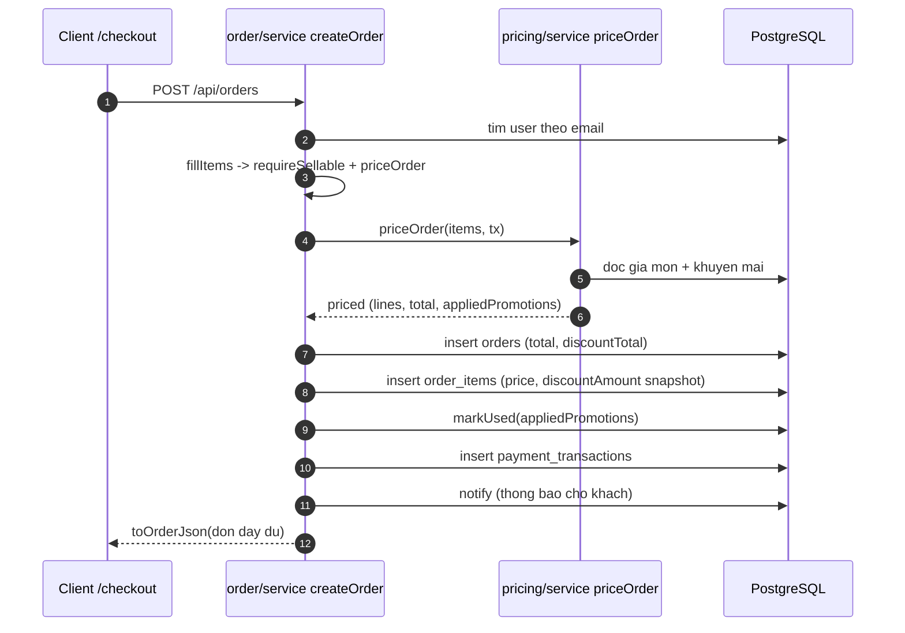
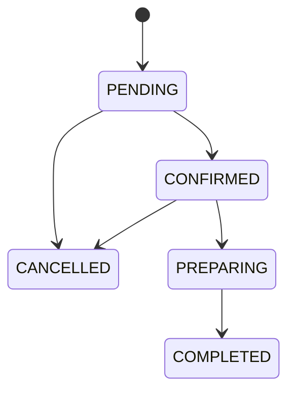

# Luong dat mon va thanh toan

Trang nay di theo mot don tu luc dat toi luc hoan thanh hoac huy, cung cac rang buoc ve trang thai, thanh toan va khuyen mai.

## Trai nghiem tren man hinh

- `/checkout` hien thi gio hien tai, form nguoi nhan, chon COD hoac QR, tong tien.
- Sau khi dat, chuyen toi `/orders` voi don moi nhat o dau. Don QR chua tra tien co dong ho dem nguoc.
- Nut thanh toan bi khoa khi het han; danh sach tu tai lai sau khi server kip quet.
- Nut huy chi hien khi don `PENDING` va chua tra tien. Nut dat lai chi hien khi don `COMPLETED`.

## So do tuan tu: tao don



## Tao don

Endpoint `POST /api/orders`, schema o `server/src/user/order/schema.ts:13-20`.

Luong server (`server/src/user/order/service.ts:88-141`):

1. Tim user theo email.
2. Trong mot transaction:
   - `fillItems` (`service.ts:56-72`) kiem mon con ban roi goi `priceOrder` de tinh gia.
   - Insert `orders` voi `total` va `discountTotal` do server tinh.
   - Insert `order_items`, moi dong `price` va `discountAmount` la anh chup tai luc mua.
   - `markUsed` tang `used_count` cua khuyen mai da ap, bang update co dieu kien de khong vuot `usage_limit`.
   - Insert `payment_transactions` voi `amount` bang tong don.
   - `notify` tao thong bao cho khach.
3. Tra don day du qua `toOrderJson`.

Gia luon lay tu DB, khong tin client (`server/src/user/order/service.ts:73-78` goi `client.query.foods.findFirst`).

### Code: tao don trong transaction

Toa do: `server/src/user/order/service.ts:88-141`.

Vao: `email` va `CreateOrderRequest`. Ra: `OrderJson`.

```ts
export async function createOrder(email: string, req: CreateOrderRequest) {
  const user = await db.query.users.findFirst({ where: eq(users.email, email) });
  if (!user) throw badRequest("Phien dang nhap khong hop le");

  const createdOrder = await db.transaction(async (tx) => {
    const { items, priced } = await fillItems(tx, req.items); // kiem ban + tinh gia
    const [created] = await tx.insert(orders).values({
      userId: user.id,
      receiverName: req.receiverName,
      phone: req.phone,
      address: req.address,
      paymentMethod: req.paymentMethod,
      note: trimNote(req.note),
      total: String(priced.total),
      discountTotal: String(priced.discountTotal),
    }).returning();
    if (!created) throw new Error("Khong the tao don hang");

    if (items.length > 0) {
      await tx.insert(orderItems).values(
        items.map((it) => ({
          orderId: created.id,
          foodId: it.foodId,
          quantity: it.quantity,
          price: String(it.price),
          discountAmount: String(it.discountAmount), // anh chup gia luc mua
        })),
      );
    }
    await markUsed(priced.appliedPromotions, tx); // tru luot KM trong cung transaction
    await tx.insert(paymentTransactions).values({
      orderId: created.id,
      method: created.paymentMethod,
      amount: String(created.total),
    });
    await notify(tx, { id: created.id, userId: user.id },
      `Don hang #${created.id} da duoc tao. Chung toi se som xac nhan don cua ban.`);
    return tx.query.orders.findFirst({ where: eq(orders.id, created.id), with: ORDER_WITH });
  });
  return toOrderJson(createdOrder!);
}
```

Tung buoc:
- `service.ts:92`: mo transaction de tat ca thanh cong hoac rollback.
- `service.ts:93`: `fillItems` kiem mon con ban va tinh gia.
- `service.ts:94-106`: insert `orders` voi tong tien do server tinh.
- `service.ts:109-119`: insert `order_items`, gia la anh chup.
- `service.ts:122`: tru luot khuyen mai trong cung transaction.
- `service.ts:123-127`: tao giao dich thanh toan.
- `service.ts:128-132`: thong bao cho khach.

Vi sao: gom vao transaction de khong co trang thai nua voi (don tao nhung chua co giao dich, hoac KM tru nhung don that bai).

## Luat chuyen trang thai



- `PREPARING` nghia la "Dang van chuyen", ma DB khong doi.
- Khong the huy sau `PREPARING`.
- `PENDING -> CONFIRMED` voi QR bat buoc `payment_status = PAID` (`server/src/user/order/transitions.ts:12-15` va `service.ts:41-43`).
- Luat thuan o `server/src/user/order/transitions.ts:16-31`, tach rieng de test duoc.
- Nhan hien thi o `ORDER_STATUS_LABEL` (`transitions.ts:4-10`).

`transition(order, next)` kiem ca luat chuyen va dieu kien thanh toan (`service.ts:31-45`).

### Code: luat chuyen trang thai

Toa do: `server/src/user/order/transitions.ts:16-31` va `server/src/user/order/service.ts:31-45`.

Vao: `order` (status, paymentMethod, paymentStatus) va `next`. Ra: cap nhat `order.status` hoac nem 400.

```ts
// transitions.ts: luat chuyen mot chieu.
export function isValidTransition(from: OrderStatus, to: OrderStatus): boolean {
  const allowed: Record<OrderStatus, OrderStatus[]> = {
    PENDING: ["CONFIRMED", "CANCELLED"],
    CONFIRMED: ["PREPARING", "CANCELLED"],
    PREPARING: ["COMPLETED"],
    COMPLETED: [],
    CANCELLED: [],
  };
  return allowed[from].includes(to);
}

// service.ts: ap luat + dieu kien thanh toan QR.
export function transition(order, next) {
  if (!isValidTransition(order.status, next)) {
    throw badRequest(`Khong the chuyen don tu "${ORDER_STATUS_LABEL[order.status]}" sang "${ORDER_STATUS_LABEL[next]}"`);
  }
  // QR thanh toan truoc nen phai da thu tien moi xac nhan duoc; COD thu khi giao nen duyet binh thuong.
  if (next === "CONFIRMED" && order.paymentMethod === "QR" && order.paymentStatus !== "PAID") {
    throw badRequest("Don chua thanh toan nen chua the xac nhan");
  }
  order.status = next;
}
```

Vi sao: tach luat chuyen thanh ham thuan de test duoc; guard QR tranh xac nhan don chua tra tien.

## Thanh toan

- `paymentMethod` la `COD` hoac `QR`.
- COD tra tien khi giao, nen khong co han thanh toan.
- QR chua tra tien qua `ORDER_PAYMENT_TIMEOUT_MINUTES` (mac dinh 30) thi job het han huy don (`server/src/user/order/expiry.ts` va `expiryJob.ts`).
- `updatePayment(order, paid)` (`service.ts:223-228`) cap nhat ca `orders.payment_status` va `payment_transactions`.
- Guard race: neu don vua bi job huy, `applyPaymentTx` khong ghi `PAID` (`service.ts:189-201`), chan tinh huong khach bam "Da chuyen khoan" dung luc job chay.
- `toOrderJson` tra them `paymentDeadlineAt` (`server/src/lib/serializers.ts`), null voi COD, don da tra tien hoac da chot.

### Code: guard race khi thanh toan

Toa do: `server/src/user/order/service.ts:183-221`.

Vao: `order`, `paid`. Ra: order da cap nhat hoac loi 400 neu don da huy.

```ts
async function applyPaymentTx(tx, order, paid) {
  const next = paid ? "PAID" : "UNPAID";
  // Don vua bi sweeper huy thi khong duoc ghi PAID: chan race giua "Da chuyen khoan" va job qua han.
  const updatedRows = await tx.update(orders)
    .set({ paymentStatus: next })
    .where(
      paid
        ? and(eq(orders.id, order.id), ne(orders.status, "CANCELLED"))
        : eq(orders.id, order.id),
    )
    .returning({ id: orders.id });
  if (paid && updatedRows.length === 0) {
    throw badRequest("Don da huy nen khong thanh toan duoc");
  }

  await tx.update(paymentTransactions)
    .set(paid ? { status: "PAID", paidAt: new Date() } : { status: "PENDING", paidAt: null })
    .where(eq(paymentTransactions.orderId, order.id));

  await notify(tx, order, paid ? `Don hang #${order.id} da duoc ghi nhan thanh toan.` : `Don hang #${order.id} chuyen ve trang thai chua thanh toan.`);
  const updated = await tx.query.orders.findFirst({ where: eq(orders.id, order.id), with: ORDER_WITH });
  return updated!;
}
```

Vi sao: dieu kien `ne(orders.status, "CANCELLED")` lam update khong khop don da huy, nen khong ghi PAID len don da huy.

## Huy don

Khach chi huy duoc don `PENDING` + `UNPAID` (`server/src/user/order/service.ts:156-180`):

1. Kiem chu don (`ownOrder`, `service.ts:243-253`).
2. Kiem trang thai va thanh toan.
3. Trong transaction: set `status = CANCELLED`, gui thong bao.
4. **Khong hoan `used_count`** cua khuyen mai, giong luong tu huy.

`canCancelOrder` o `client/src/shared/utils/orders.ts` an nut o client, nhung kiem that o server.

### Code: huy don

Toa do: `server/src/user/order/service.ts:156-180`.

```ts
export async function cancelOrder(email: string, id: number) {
  const order = await ownOrder(email, id);
  if (order.status !== "PENDING") {
    throw badRequest("Chi don dang cho xac nhan moi huy duoc. Vui long lien he hotline.");
  }
  if (order.paymentStatus === "PAID") {
    throw badRequest("Don hang da thanh toan khong the tu huy tren he thong.");
  }
  const saved = await db.transaction(async (tx) => {
    await tx.update(orders).set({ status: "CANCELLED" }).where(eq(orders.id, order.id));
    await notify(tx, order, `Don hang #${id} da duoc huy theo yeu cau cua ban.`);
    return tx.query.orders.findFirst({ where: eq(orders.id, order.id), with: ORDER_WITH });
  });
  return toOrderJson(saved!);
}
```

Vi sao: chan huy don da vao che bien hoac da tra tien; khong hoan KM giong tu huy.

## Sua don o quan tri

Mon chi sua duoc khi don `PENDING` va `UNPAID` (`canEditItems`, `transitions.ts:12`). Don `COMPLETED` hoac `CANCELLED` khoa hoan toan ke ca thong tin giao hang (`adminUpdateOrder`, `server/src/admin/order/service.ts:148-152`).

Cac trang thai con lai chi sua duoc nguoi nhan, SĐT, dia chi, ghi chu va trang thai.

Khi doi mon (`adminUpdateOrder`, `server/src/admin/order/service.ts:145-264`):

- `items: []` nghia la **khong doi mon**, chi sua thong tin giao hang.
- Doi mon thi tinh lai gia mon cu de tra lai `usedCount` cua khuyen mai cu, roi `markUsed` khuyen mai moi (`syncPromotionUsage`).

## Don admin tao moi

`adminCreateOrder` (`server/src/admin/order/service.ts:72-143`) luon bat dau `PENDING`, chi tao duoc trang thai di tiep duoc tu `PENDING` (`PENDING`, `CONFIRMED`, `CANCELLED`, xem `isCreatableStatus` o `transitions.ts:38`). `CONFIRMED` + `QR` phai da thu tien.

## Xoa don

`adminDeleteOrder` (`server/src/admin/order/service.ts:265-276`) xoa trong mot transaction gom thong bao, giao dich thanh toan, dong mon va don, de khong con du lieu moc. `notifications.order_id` khong co khoa ngoai nen phai xoa bang tay.

## Job het han

`server/src/user/order/expiryJob.ts` quet ngay khi khoi dong roi moi 60 giay bang mot cau `UPDATE ... WHERE` co dieu kien, nen don vua thanh toan xong khong khop. Thong bao tao cung transaction. Chi don `PENDING` + `UNPAID` + `QR` tao qua han moi bi huy.

## Khuyen mai trong tinh tien

`priceOrder` chay hai vong (`server/src/user/pricing/service.ts:61-115`):

1. Vong mot cong tong de biet don co dat `min_order_total` khong.
2. Vong hai chon khuyen mai tot nhat cho tung dong theo tong don da biet.

Moi dong chi nhan mot khuyen mai tu dong tot nhat. Client khong nhan phan tram hay tru khuyen mai, chi hien lai `QuoteLine.lineDiscount` (so tien giam cua ca dong).

### Code: tinh gia hai vong

Toa do: `server/src/user/pricing/service.ts:61-115`.

Vao: danh sach item (foodId, quantity). Ra: `PricedCart` (lines, subtotal, discountTotal, total, appliedPromotions).

```ts
export async function priceOrder(items, client = db, now = new Date()) {
  // Vong 1: lay gia mon va tinh tong don.
  const prepared = [];
  let subtotal = 0;
  for (const input of items) {
    const food = await client.query.foods.findFirst({ where: eq(foods.id, input.foodId), with: { category: true } });
    if (!food) throw badRequest("Mon khong ton tai");
    if (!food.available) throw badRequest(`Mon "${food.name}" da ngung phuc vu`);
    const unitPrice = Number(food.price);
    prepared.push({ input, food, unitPrice });
    subtotal += unitPrice * input.quantity;
  }

  // Vong 2: chon khuyen mai theo tong don (minOrderReached).
  const rules = await buildRules(now, client, subtotal);
  const lines = [];
  const applied = new Map();
  for (const { input, food, unitPrice } of prepared) {
    const auto = bestFor(unitPrice, food, rules); // chon KM tot nhat cho dong
    let lineDiscount = 0, label = null;
    if (auto) {
      lineDiscount = discountAmount(unitPrice, auto) * input.quantity;
      label = auto.name;
      applied.set(auto.id, auto);
    }
    lines.push({ food, quantity: input.quantity, unitPrice, lineDiscount, discountLabel: label });
  }
  const total = lines.reduce((sum, l) => sum + (l.unitPrice * l.quantity - l.lineDiscount), 0);
  return { lines, subtotal, discountTotal: subtotal - total, total, appliedPromotions: [...applied.values()] };
}
```

Vi sao: gom thanh mot vong se ap sai khuyen mai co han muc (chua biet tong don); `bestFor` chon KM tot nhat cho tung dong, moi dong chi nhan mot KM.

`markUsed` tang `used_count` bang update co dieu kien (`server/src/user/pricing/service.ts:163-179`), de hai don toi cung luc khong vuot `usage_limit`.

## Bao cao theo ngay

`from`/`to` cua `/api/admin/reports/**` doc bang `parseBusinessRange` (`server/src/lib/businessTime.ts`): chuoi `"YYYY-MM-DD"` la ngay lich Viet, chuoi ISO giu nguyen instant, ngay sai hoac `from > to` tra 400.

Tiep theo: [Luong chatbot](Luong-chatbot) de hieu cach tro ly AI tra loi.
