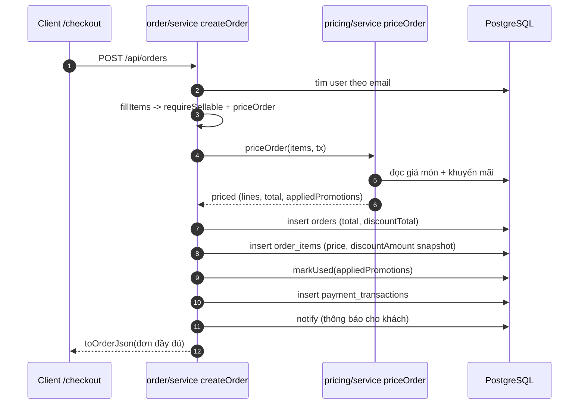
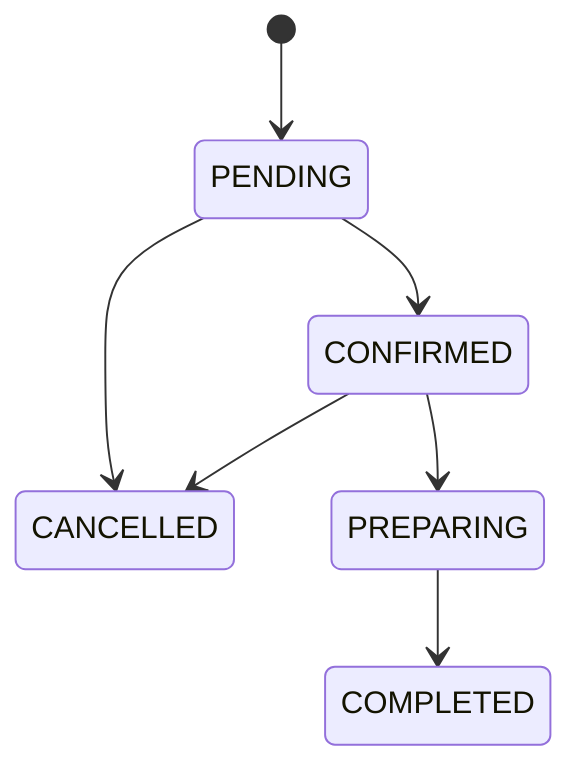

# Luồng đặt món và thanh toán

Trang này đi theo một đơn từ lúc đặt tới lúc hoàn thành hoặc hủy, cùng các ràng buộc về trạng thái, thanh toán và khuyến mãi.

## Trải nghiệm trên màn hình

- `/checkout` hiển thị giỏ hiện tại, form người nhận, chọn COD hoặc QR, tổng tiền.
- Sau khi đặt, chuyển tới `/orders` với đơn mới nhất ở đầu. Đơn QR chưa trả tiền có đồng hồ đếm ngược.
- Nút thanh toán bị khóa khi hết hạn; danh sách tự tải lại sau khi server kịp quét.
- Nút hủy chỉ hiện khi đơn `PENDING` và chưa trả tiền. Nút đặt lại chỉ hiện khi đơn `COMPLETED`.

## Sơ đồ tuần tự: tạo đơn



## Tạo đơn

Endpoint `POST /api/orders`, schema ở `server/src/user/order/schema.ts:13-20`.

Luồng server (`server/src/user/order/service.ts:88-141`):

1. Tìm user theo email.
2. Trong một transaction:
   - `fillItems` (`service.ts:56-72`) kiểm món còn bán rồi gọi `priceOrder` để tính giá.
   - Insert `orders` với `total` và `discountTotal` do server tính.
   - Insert `order_items`, mỗi dòng `price` và `discountAmount` là ảnh chụp tại lúc mua.
   - `markUsed` tăng `used_count` của khuyến mãi đã áp, bằng update có điều kiện để không vượt `usage_limit`.
   - Insert `payment_transactions` với `amount` bằng tổng đơn.
   - `notify` tạo thông báo cho khách.
3. Trả đơn đầy đủ qua `toOrderJson`.

Giá luôn lấy từ DB, không tin client (`server/src/user/order/service.ts:73-78` gọi `client.query.foods.findFirst`).

### Code: tạo đơn trong transaction

Tọa độ: `server/src/user/order/service.ts:88-141`.

Vào: `email` và `CreateOrderRequest`. Ra: `OrderJson`.

```ts
export async function createOrder(email: string, req: CreateOrderRequest) {
  const user = await db.query.users.findFirst({ where: eq(users.email, email) });
  if (!user) throw badRequest("Phien dang nhap khong hop le");

  const createdOrder = await db.transaction(async (tx) => {
    const { items, priced } = await fillItems(tx, req.items); // kiem ban + tinh gia
    const [created] = await tx.insert(orders).values({
      userId: user.id,
      receiverName: req.receiverName,
      phone: req.phone,
      address: req.address,
      paymentMethod: req.paymentMethod,
      note: trimNote(req.note),
      total: String(priced.total),
      discountTotal: String(priced.discountTotal),
    }).returning();
    if (!created) throw new Error("Khong the tao don hang");

    if (items.length > 0) {
      await tx.insert(orderItems).values(
        items.map((it) => ({
          orderId: created.id,
          foodId: it.foodId,
          quantity: it.quantity,
          price: String(it.price),
          discountAmount: String(it.discountAmount), // anh chup gia luc mua
        })),
      );
    }
    await markUsed(priced.appliedPromotions, tx); // tru luot KM trong cung transaction
    await tx.insert(paymentTransactions).values({
      orderId: created.id,
      method: created.paymentMethod,
      amount: String(created.total),
    });
    await notify(tx, { id: created.id, userId: user.id },
      `Don hang #${created.id} da duoc tao. Chung toi se som xac nhan don cua ban.`);
    return tx.query.orders.findFirst({ where: eq(orders.id, created.id), with: ORDER_WITH });
  });
  return toOrderJson(createdOrder!);
}
```

Từng bước:
- `service.ts:92`: mở transaction để tất cả thành công hoặc rollback.
- `service.ts:93`: `fillItems` kiểm món còn bán và tính giá.
- `service.ts:94-106`: insert `orders` với tổng tiền do server tính.
- `service.ts:109-119`: insert `order_items`, giá là ảnh chụp.
- `service.ts:122`: trừ lượt khuyến mãi trong cùng transaction.
- `service.ts:123-127`: tạo giao dịch thanh toán.
- `service.ts:128-132`: thông báo cho khách.

Vì sao: gom vào transaction để không có trạng thái nửa vời (đơn tạo nhưng chưa có giao dịch, hoặc KM trừ nhưng đơn thất bại).

## Luật chuyển trạng thái



- `PREPARING` nghĩa là "Đang vận chuyển", mã DB không đổi.
- Không thể hủy sau `PREPARING`.
- `PENDING -> CONFIRMED` với QR bắt buộc `payment_status = PAID` (`server/src/user/order/transitions.ts:12-15` và `service.ts:41-43`).
- Luật thuần ở `server/src/user/order/transitions.ts:16-31`, tách riêng để test được.
- Nhãn hiển thị ở `ORDER_STATUS_LABEL` (`transitions.ts:4-10`).

`transition(order, next)` kiểm cả luật chuyển và điều kiện thanh toán (`service.ts:31-45`).

### Code: luật chuyển trạng thái

Tọa độ: `server/src/user/order/transitions.ts:16-31` và `server/src/user/order/service.ts:31-45`.

Vào: `order` (status, paymentMethod, paymentStatus) và `next`. Ra: cập nhật `order.status` hoặc ném 400.

```ts
// transitions.ts: luat chuyen mot chieu.
export function isValidTransition(from: OrderStatus, to: OrderStatus): boolean {
  const allowed: Record<OrderStatus, OrderStatus[]> = {
    PENDING: ["CONFIRMED", "CANCELLED"],
    CONFIRMED: ["PREPARING", "CANCELLED"],
    PREPARING: ["COMPLETED"],
    COMPLETED: [],
    CANCELLED: [],
  };
  return allowed[from].includes(to);
}

// service.ts: ap luat + dieu kien thanh toan QR.
export function transition(order, next) {
  if (!isValidTransition(order.status, next)) {
    throw badRequest(`Khong the chuyen don tu "${ORDER_STATUS_LABEL[order.status]}" sang "${ORDER_STATUS_LABEL[next]}"`);
  }
  // QR thanh toan truoc nen phai da thu tien moi xac nhan duoc; COD thu khi giao nen duyet binh thuong.
  if (next === "CONFIRMED" && order.paymentMethod === "QR" && order.paymentStatus !== "PAID") {
    throw badRequest("Don chua thanh toan nen chua the xac nhan");
  }
  order.status = next;
}
```

Vì sao: tách luật chuyển thành hàm thuần để test được; guard QR tránh xác nhận đơn chưa trả tiền.

## Thanh toán

- `paymentMethod` là `COD` hoặc `QR`.
- COD trả tiền khi giao, nên không có hạn thanh toán.
- QR chưa trả tiền quá `ORDER_PAYMENT_TIMEOUT_MINUTES` (mặc định 30) thì job hết hạn hủy đơn (`server/src/user/order/expiry.ts` và `expiryJob.ts`).
- `updatePayment(order, paid)` (`service.ts:223-228`) cập nhật cả `orders.payment_status` và `payment_transactions`.
- Guard race: nếu đơn vừa bị job hủy, `applyPaymentTx` không ghi `PAID` (`service.ts:189-201`), chặn tình huống khách bấm "Đã chuyển khoản" đúng lúc job chạy.
- `toOrderJson` trả thêm `paymentDeadlineAt` (`server/src/lib/serializers.ts`), null với COD, đơn đã trả tiền hoặc đã chốt.

### Code: guard race khi thanh toán

Tọa độ: `server/src/user/order/service.ts:183-221`.

Vào: `order`, `paid`. Ra: order đã cập nhật hoặc lỗi 400 nếu đơn đã hủy.

```ts
async function applyPaymentTx(tx, order, paid) {
  const next = paid ? "PAID" : "UNPAID";
  // Don vua bi sweeper huy thi khong duoc ghi PAID: chan race giua "Da chuyen khoan" va job qua han.
  const updatedRows = await tx.update(orders)
    .set({ paymentStatus: next })
    .where(
      paid
        ? and(eq(orders.id, order.id), ne(orders.status, "CANCELLED"))
        : eq(orders.id, order.id),
    )
    .returning({ id: orders.id });
  if (paid && updatedRows.length === 0) {
    throw badRequest("Don da huy nen khong thanh toan duoc");
  }

  await tx.update(paymentTransactions)
    .set(paid ? { status: "PAID", paidAt: new Date() } : { status: "PENDING", paidAt: null })
    .where(eq(paymentTransactions.orderId, order.id));

  await notify(tx, order, paid ? `Don hang #${order.id} da duoc ghi nhan thanh toan.` : `Don hang #${order.id} chuyen ve trang thai chua thanh toan.`);
  const updated = await tx.query.orders.findFirst({ where: eq(orders.id, order.id), with: ORDER_WITH });
  return updated!;
}
```

Vì sao: điều kiện `ne(orders.status, "CANCELLED")` làm update không khớp đơn đã hủy, nên không ghi PAID lên đơn đã hủy.

## Hủy đơn

Khách chỉ hủy được đơn `PENDING` + `UNPAID` (`server/src/user/order/service.ts:156-180`):

1. Kiểm chủ đơn (`ownOrder`, `service.ts:243-253`).
2. Kiểm trạng thái và thanh toán.
3. Trong transaction: set `status = CANCELLED`, gửi thông báo.
4. **Không hoàn `used_count`** của khuyến mãi, giống luồng tự hủy.

`canCancelOrder` ở `client/src/shared/utils/orders.ts` ẩn nút ở client, nhưng kiểm thật ở server.

### Code: hủy đơn

Tọa độ: `server/src/user/order/service.ts:156-180`.

```ts
export async function cancelOrder(email: string, id: number) {
  const order = await ownOrder(email, id);
  if (order.status !== "PENDING") {
    throw badRequest("Chi don dang cho xac nhan moi huy duoc. Vui long lien he hotline.");
  }
  if (order.paymentStatus === "PAID") {
    throw badRequest("Don hang da thanh toan khong the tu huy tren he thong.");
  }
  const saved = await db.transaction(async (tx) => {
    await tx.update(orders).set({ status: "CANCELLED" }).where(eq(orders.id, order.id));
    await notify(tx, order, `Don hang #${id} da duoc huy theo yeu cau cua ban.`);
    return tx.query.orders.findFirst({ where: eq(orders.id, order.id), with: ORDER_WITH });
  });
  return toOrderJson(saved!);
}
```

Vì sao: chặn hủy đơn đã vào chế biến hoặc đã trả tiền; không hoàn KM giống tự hủy.

## Sửa đơn ở quản trị

Món chỉ sửa được khi đơn `PENDING` và `UNPAID` (`canEditItems`, `transitions.ts:12`). Đơn `COMPLETED` hoặc `CANCELLED` khóa hoàn toàn kể cả thông tin giao hàng (`adminUpdateOrder`, `server/src/admin/order/service.ts:148-152`).

Các trạng thái còn lại chỉ sửa được người nhận, SĐT, địa chỉ, ghi chú và trạng thái.

Khi đổi món (`adminUpdateOrder`, `server/src/admin/order/service.ts:145-264`):

- `items: []` nghĩa là **không đổi món**, chỉ sửa thông tin giao hàng.
- Đổi món thì tính lại giá món cũ để trả lại `usedCount` của khuyến mãi cũ, rồi `markUsed` khuyến mãi mới (`syncPromotionUsage`).

## Đơn admin tạo mới

`adminCreateOrder` (`server/src/admin/order/service.ts:72-143`) luôn bắt đầu `PENDING`, chỉ tạo được trạng thái đi tiếp được từ `PENDING` (`PENDING`, `CONFIRMED`, `CANCELLED`, xem `isCreatableStatus` ở `transitions.ts:38`). `CONFIRMED` + `QR` phải đã thu tiền.

## Xóa đơn

`adminDeleteOrder` (`server/src/admin/order/service.ts:265-276`) xóa trong một transaction gồm thông báo, giao dịch thanh toán, dòng món và đơn, để không còn dữ liệu móc. `notifications.order_id` không có khóa ngoại nên phải xóa bằng tay.

## Job hết hạn

`server/src/user/order/expiryJob.ts` quét ngay khi khởi động rồi mỗi 60 giây bằng một câu `UPDATE ... WHERE` có điều kiện, nên đơn vừa thanh toán xong không khớp. Thông báo tạo cùng transaction. Chỉ đơn `PENDING` + `UNPAID` + `QR` tạo quá hạn mới bị hủy.

## Khuyến mãi trong tính tiền

`priceOrder` chạy hai vòng (`server/src/user/pricing/service.ts:61-115`):

1. Vòng một cộng tổng để biết đơn có đạt `min_order_total` không.
2. Vòng hai chọn khuyến mãi tốt nhất cho từng dòng theo tổng đơn đã biết.

Mỗi dòng chỉ nhận một khuyến mãi tự động tốt nhất. Client không nhân phần trăm hay trừ khuyến mãi, chỉ hiện lại `QuoteLine.lineDiscount` (số tiền giảm của cả dòng).

### Code: tính giá hai vòng

Tọa độ: `server/src/user/pricing/service.ts:61-115`.

Vào: danh sách item (foodId, quantity). Ra: `PricedCart` (lines, subtotal, discountTotal, total, appliedPromotions).

```ts
export async function priceOrder(items, client = db, now = new Date()) {
  // Vong 1: lay gia mon va tinh tong don.
  const prepared = [];
  let subtotal = 0;
  for (const input of items) {
    const food = await client.query.foods.findFirst({ where: eq(foods.id, input.foodId), with: { category: true } });
    if (!food) throw badRequest("Mon khong ton tai");
    if (!food.available) throw badRequest(`Mon "${food.name}" da ngung phuc vu`);
    const unitPrice = Number(food.price);
    prepared.push({ input, food, unitPrice });
    subtotal += unitPrice * input.quantity;
  }

  // Vong 2: chon khuyen mai theo tong don (minOrderReached).
  const rules = await buildRules(now, client, subtotal);
  const lines = [];
  const applied = new Map();
  for (const { input, food, unitPrice } of prepared) {
    const auto = bestFor(unitPrice, food, rules); // chon KM tot nhat cho dong
    let lineDiscount = 0, label = null;
    if (auto) {
      lineDiscount = discountAmount(unitPrice, auto) * input.quantity;
      label = auto.name;
      applied.set(auto.id, auto);
    }
    lines.push({ food, quantity: input.quantity, unitPrice, lineDiscount, discountLabel: label });
  }
  const total = lines.reduce((sum, l) => sum + (l.unitPrice * l.quantity - l.lineDiscount), 0);
  return { lines, subtotal, discountTotal: subtotal - total, total, appliedPromotions: [...applied.values()] };
}
```

Vì sao: gom thành một vòng sẽ áp sai khuyến mãi có hạn mức (chưa biết tổng đơn); `bestFor` chọn KM tốt nhất cho từng dòng, mỗi dòng chỉ nhận một KM.

`markUsed` tăng `used_count` bằng update có điều kiện (`server/src/user/pricing/service.ts:163-179`), để hai đơn tới cùng lúc không vượt `usage_limit`.

## Báo cáo theo ngày

`from`/`to` của `/api/admin/reports/**` đọc bằng `parseBusinessRange` (`server/src/lib/businessTime.ts`): chuỗi `"YYYY-MM-DD"` là ngày lịch Việt, chuỗi ISO giữ nguyên instant, ngày sai hoặc `from > to` trả 400.

Tiếp theo: [Luồng chatbot](Luong-chatbot) để hiểu cách trợ lý AI trả lời.
