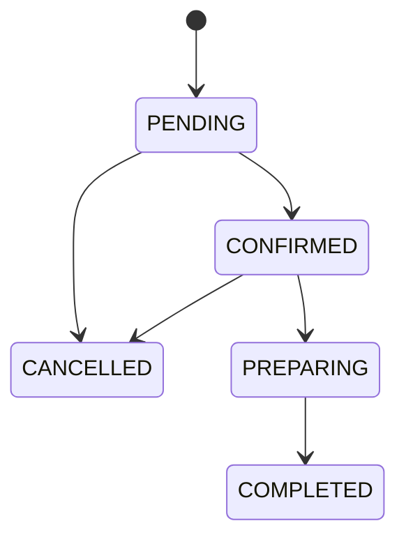

# Đặt món và thanh toán

Trang này đi theo một đơn từ lúc đặt tới lúc hoàn thành hoặc huỷ, cùng các ràng buộc về trạng thái, thanh toán và khuyến mãi.

## Trải nghiệm trên màn hình

- `/checkout` hiển thị giỏ hiện tại, form người nhận, chọn COD hoặc QR, tổng tiền.
- Sau khi đặt, chuyển tới `/orders` với đơn mới nhất ở đầu. Đơn QR chưa trả tiền có đồng hồ đếm ngược.
- Nút thanh toán bị khoá khi hết hạn; danh sách tự tải lại sau khi server kịp quét.
- Nút huỷ chỉ hiện khi đơn `PENDING` và chưa trả tiền. Nút đặt lại chỉ hiện khi đơn `COMPLETED`.

## Tạo đơn

Endpoint `POST /api/orders`, schema ở `server/src/user/order/schema.ts:13-20`.

Luồng server (`server/src/user/order/service.ts:88-141`):

1. Tìm user theo email.
2. Trong một transaction:
   - `fillItems` (`service.ts:56-72`) kiểm món còn bán rồi gọi `priceOrder` để tính giá.
   - Insert `orders` với `total` và `discountTotal` do server tính.
   - Insert `order_items`, mỗi dòng `price` và `discountAmount` là ảnh chụp tại lúc mua.
   - `markUsed` tăng `used_count` của khuyến mãi đã áp, bằng update có điều kiện để không vượt `usage_limit`.
   - Insert `payment_transactions` với `amount` bằng tổng đơn.
   - `notify` tạo thông báo cho khách.
3. Trả đơn đầy đủ qua `toOrderJson`.

Giá luôn lấy từ DB, không tin client (`server/src/user/order/service.ts:73-78` gọi `client.query.foods.findFirst`).

## Luật chuyển trạng thái

- `PREPARING` nghĩa là \"Đang vận chuyển\", mã DB không đổi.
- Không thể huỷ sau `PREPARING`.
- `PENDING → CONFIRMED` với QR bắt buộc `payment_status = PAID` (`server/src/user/order/transitions.ts:12-15` và `service.ts:41-43`).
- Luật thuần ở `server/src/user/order/transitions.ts:16-31`, tách riêng để test được.
- Nhãn hiển thị ở `ORDER_STATUS_LABEL` (`transitions.ts:4-10`).

`transition(order, next)` kiểm cả luật chuyển và điều kiện thanh toán (`service.ts:31-45`).

## Thanh toán

- `paymentMethod` là `COD` hoặc `QR`.
- COD trả tiền khi giao, nên không có hạn thanh toán.
- QR chưa trả tiền quá `ORDER_PAYMENT_TIMEOUT_MINUTES` (mặc định 30) thì job hết hạn huỷ đơn (`server/src/user/order/expiry.ts` và `expiryJob.ts`).
- `updatePayment(order, paid)` (`service.ts:223-228`) cập nhật cả `orders.payment_status` và `payment_transactions`.
- Guard race: nếu đơn vừa bị job huỷ, `applyPaymentTx` không ghi `PAID` (`service.ts:189-201`), chặn tình huống khách bấm \"Đã chuyển khoản\" đúng lúc job chạy.
- `toOrderJson` trả thêm `paymentDeadlineAt` (`server/src/lib/serializers.ts`), null với COD, đơn đã trả tiền hoặc đã chốt.

## Huỷ đơn

Khách chỉ huỷ được đơn `PENDING` + `UNPAID` (`server/src/user/order/service.ts:156-180`):

1. Kiểm chủ đơn (`ownOrder`, `service.ts:243-253`).
2. Kiểm trạng thái và thanh toán.
3. Trong transaction: set `status = CANCELLED`, gửi thông báo.
4. **Không hoàn `used_count`** của khuyến mãi, giống luồng tự huỷ.

`canCancelOrder` ở `client/src/shared/utils/orders.ts` ẩn nút ở client, nhưng kiểm thật ở server.

## Sửa đơn ở quản trị

Món chỉ sửa được khi đơn `PENDING` và `UNPAID` (`canEditItems`, `transitions.ts:12`). Đơn `COMPLETED` hoặc `CANCELLED` khoá hoàn toàn kể cả thông tin giao hàng (`adminUpdateOrder`, `server/src/admin/order/service.ts:148-152`).

Các trạng thái còn lại chỉ sửa được người nhận, SĐT, địa chỉ, ghi chú và trạng thái.

Khi đổi món (`adminUpdateOrder`, `server/src/admin/order/service.ts:145-264`):

- `items: []` nghĩa là **không đổi món**, chỉ sửa thông tin giao hàng.
- Đổi món thì tính lại giá món cũ để trả lại `usedCount` của khuyến mãi cũ, rồi `markUsed` khuyến mãi mới (`syncPromotionUsage`).

## Đơn admin tạo mới

`adminCreateOrder` (`server/src/admin/order/service.ts:72-143`) luôn bắt đầu `PENDING`, chỉ tạo được trạng thái đi tiếp được từ `PENDING` (`PENDING`, `CONFIRMED`, `CANCELLED`, xem `isCreatableStatus` ở `transitions.ts:38`). `CONFIRMED` + `QR` phải đã thu tiền.

## Xoá đơn

`adminDeleteOrder` (`server/src/admin/order/service.ts:265-276`) xoá trong một transaction gồm thông báo, giao dịch thanh toán, dòng món và đơn, để không còn dữ liệu móc. `notifications.order_id` không có khoá ngoại nên phải xoá bằng tay.

## Job hết hạn

`server/src/user/order/expiryJob.ts` quét ngay khi khởi động rồi mỗi 60 giây bằng một câu `UPDATE ... WHERE` có điều kiện, nên đơn vừa thanh toán xong không khớp. Thông báo tạo cùng transaction. Chỉ đơn `PENDING` + `UNPAID` + `QR` tạo quá hạn mới bị huỷ.

## Khuyến mãi trong tính tiền

`priceOrder` chạy hai vòng (`server/src/user/pricing/service.ts:61-115`):

1. Vòng một cộng tổng để biết đơn có đạt `min_order_total` không.
2. Vòng hai chọn khuyến mãi tốt nhất cho từng dòng theo tổng đơn đã biết.

Mỗi dòng chỉ nhận một khuyến mãi tự động tốt nhất. Client không nhân phần trăm hay trừ khuyến mãi, chỉ hiện lại `QuoteLine.lineDiscount` (số tiền giảm của cả dòng).

`markUsed` tăng `used_count` bằng update có điều kiện (`server/src/user/pricing/service.ts:163-179`), để hai đơn tới cùng lúc không vượt `usage_limit`.

## Báo cáo theo ngày

`from`/`to` của `/api/admin/reports/**` đọc bằng `parseBusinessRange` (`server/src/lib/businessTime.ts`): chuỗi `\"YYYY-MM-DD\"` là ngày lịch Việt, chuỗi ISO giữ nguyên instant, ngày sai hoặc `from > to` trả 400.

Tiếp theo: [Luồng chatbot](Luong-chatbot) để hiểu cách trợ lý AI trả lời.
