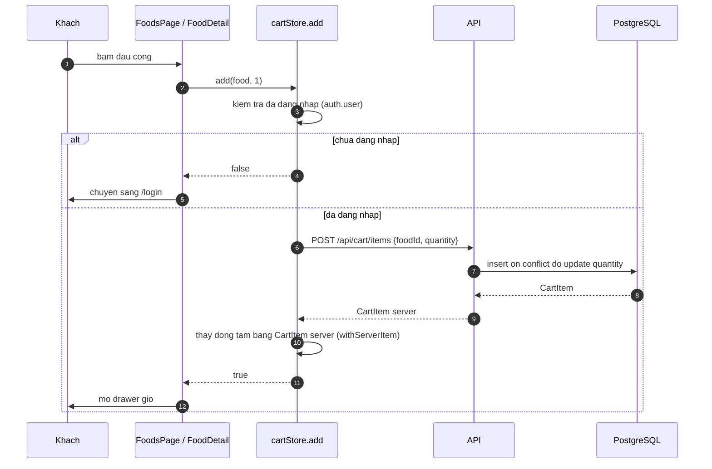
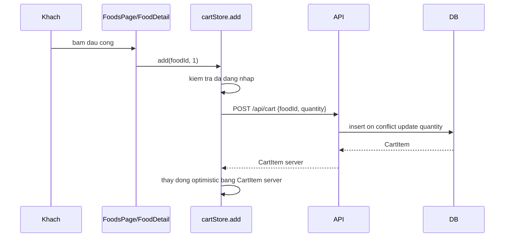

# Luong khach hang

Trang nay di theo trai nghiem cua khach: tu trang chu toi chi tiet mon, gio hang va thong bao. Trang [Dat mon va thanh toan](Luong-dat-mon) xu ly phan dat don.

## Trai nghiem tren man hinh

- Trang chu `/` la thuc don. Header sticky, chip danh muc, bo loc gia, khau phan, che do an, sap xep, phan trang 12 mon/trang.
- Bam vao anh hoac ten mon di toi `/foods/:id`, trang chi tiet trong `DefaultLayout`.
- Bam dau cong tren the mon: neu chua dang nhap thi chuyen sang `/login`, neu da dang nhap thi them vao gio va mo drawer gio.
- Nut gio tren header mo drawer toan cuc; chuong mo drawer thong bao.

## So do tuan tu: them mon vao gio



## Trang chu va loc mon

`client/src/user/menu/pages/FoodsPage.vue` doc filter tu URL query (`category`, `keyword`, `min`, `max`, `people`, `sort`, `diet`, `spicy`, `available`, `deal`, `page`) bang `useRoute().query`. Moi thay doi filter goi lai API.

Hai noi loc:

1. Server tra danh sach theo danh muc, gia, khau phan, tu khoa, con ban (`server/src/user/menu/service.ts:9-33`).
2. Client loc them theo che do an, do cay, khuyen mai dang co (`FoodsPage.vue:129-140`), vi nhung tieu chi nay la transient do pricing engine dien them vao Food.

Phan trang 12 mon/trang (`FoodsPage.vue:161-165`).

### Code: loc client theo che do an va do cay

Toa do: `client/src/user/menu/pages/FoodsPage.vue:129-140` va `:161-165`.

Vao: danh sach mon server tra ve. Ra: danh sach da loc + so trang.

```ts
// Loc them o client: che do an, do cay, con ban, khuyen mai.
const filtered = computed(() => {
  let list = foods.value ?? []
  if (diet.value) list = list.filter((f) => hasDietTag(f, diet.value!))
  if (noSpicy.value) list = list.filter((f) => f.spicyLevel === 0)
  if (onlyAvailable.value) list = list.filter((f) => f.available)
  if (onlyDeals.value) list = list.filter((f) => (f.discountPercent ?? 0) > 0)

  const sorted = [...list]
  if (sort.value === 'price-asc') sorted.sort((a, b) => priceOf(a) - priceOf(b))
  else if (sort.value === 'price-desc') sorted.sort((a, b) => priceOf(b) - priceOf(a))
  else if (sort.value === 'discount') sorted.sort((a, b) => (b.discountPercent ?? 0) - (a.discountPercent ?? 0))
  return sorted
});

// Phan trang 12 mon/trang.
const pageCount = computed(() => Math.max(1, Math.ceil(filtered.value.length / PAGE_SIZE)));
const visible = computed(() =>
  filtered.value.slice((currentPage.value - 1) * PAGE_SIZE, currentPage.value * PAGE_SIZE),
);
```

Tung buoc:
- `FoodsPage.vue:129-140`: loc them cac tieu chi transient (che do an, do cay, co khuyen mai).
- `FoodsPage.vue:161-165`: tinh so trang va cat danh sach theo trang.

Vi sao: cac tieu chi nay khong co trong query server vi la du lieu tinh them boi pricing engine; loc o client tranh goi API lai.

## Chi tiet mon

`client/src/user/menu/pages/FoodDetailPage.vue` lay mon theo id, hien thi gia goc, gia sau khuyen mai neu co (`discountedPrice`, `discountAmount`, `discountPercent`, `discountLabel` tu serializer o `server/src/lib/serializers.ts:23-33`), danh gia va nut them gio.

`GET /api/foods/:id` khong yeu cau dang nhap.

## Them vao gio

Luong day du:



- `client/src/user/cart/store.ts:70-110` `add` tra `Promise<boolean>`. Neu chua dang nhap thi tra `false` va caller dua khach sang `/login`.
- Store dung `requestSeq` (`store.ts:26-29`) de ap response dung thu tu, tranh race khi them nhanh nhieu mon.
- `withServerItem` (`store.ts:13-24`) thay dong optimistic bang `CartItem` server tra ve, de mon them tu chatbot co du field va gia dung.
- Server `addToCart` (`server/src/user/cart/service.ts:28-52`) dung `insert ... onConflictDoUpdate` cong don `quantity`, nho unique index `(user_id, food_id)` o `server/src/db/schema.ts:105-107`.
- Mon ngung phuc vu bi chan o server (`server/src/user/cart/service.ts:34-46`).

### Code: store them mon va ap response dung thu tu

Toa do: `client/src/user/cart/store.ts:13-24` va `:26-29` va `:70-110`.

Vao: `Food` va `quantity`. Ra: `Promise<boolean>` (true neu thanh cong).

```ts
// Thay dong optimistic bang CartItem server tra ve.
const withServerItem = (items: CartItem[], item: CartItem): CartItem[] => {
  const id = item.food?.id
  if (id == null) return items
  return items.some((i) => i.food?.id === id)
    ? items.map((i) => (i.food?.id === id ? item : i))
    : [...items, item]
}

// So thu tu request theo tung mon: chi response cua request moi nhat duoc ghi vao gio.
const requestSeq = new Map<number, number>()
const beginRequest = (foodId: number) => {
  const seq = (requestSeq.get(foodId) ?? 0) + 1
  requestSeq.set(foodId, seq)
  return { seq, generation: cartGeneration }
}
const canApply = (foodId: number, token) =>
  token.generation === cartGeneration && requestSeq.get(foodId) === token.seq

async add(food: Food, quantity = 1): Promise<boolean> {
  if (!loggedIn()) return false // chua dang nhap -> caller dua sang /login
  const token = beginRequest(food.id)
  const before = this.items
  const existing = before.find((i) => i.food?.id === food.id)
  this.items = existing
    ? before.map((i) => (i.food?.id === food.id ? { ...i, quantity: i.quantity + quantity } : i))
    : [...before, { food, quantity }]
  try {
    const saved = await addCartItem(food.id, quantity)
    if (canApply(food.id, token)) this.items = withServerItem(this.items, saved)
    return true
  } catch {
    if (canApply(food.id, token)) this.items = before
    return false
  }
}
```

Tung buoc:
- `store.ts:13-24`: thay dong tam bang CartItem server de du field va gia dung.
- `store.ts:26-29`: danh so thu tu request.
- `store.ts:70-110`: them optimistic, goi API, chi ap response neu la request moi nhat.

Vi sao: khi them nhanh nhieu mon, response cu co the ghi de response moi; `requestSeq` chan dieu do.

### Code: server cong don so luong

Toa do: `server/src/user/cart/service.ts:28-52`.

Vao: `email`, `foodId`, `quantity`. Ra: `CartItem` da cong don.

```ts
// Them mon vao gio, cong don so luong nho unique index (user_id, food_id).
export async function addToCart(email: string, foodId: number, quantity: number) {
  const user = await getUserOrThrow(email);
  const food = await db.query.foods.findFirst({ where: eq(foods.id, foodId) });
  if (!food) throw badRequest("Mon khong ton tai");
  if (!food.available) throw badRequest(`Mon "${food.name}" da ngung phuc vu`);

  const [item] = await db
    .insert(cartItems)
    .values({ userId: user.id, foodId, quantity })
    .onConflictDoUpdate({
      target: [cartItems.userId, cartItems.foodId],
      set: { quantity: sql`${cartItems.quantity} + ${quantity}` },
    })
    .returning();

  const saved = await db.query.cartItems.findFirst({
    where: eq(cartItems.id, item!.id),
    with: { food: { with: { category: true } } },
  });
  return toCartItemJson(saved!);
```

Tung buoc:
- `service.ts:34-46`: kiem mon ton tai va con ban.
- `service.ts:48-52`: insert, neu trung (user, food) thi cong don quantity.

Vi sao: unique index `(user_id, food_id)` (`server/src/db/schema.ts:105-107`) la dieu kien cho `onConflictDoUpdate`; tranh read-then-write.

## Gio hang

Drawer gio mo bang `uiStore` (`client/src/shared/stores/uiStore.ts`), khong phai state cuc bo. Khach chua dang nhap bam gio thi dua sang `/login` kem co `openCart` de mo lai sau dang nhap.

Quote (tinh tien) chay o `client/src/composables/useCartQuote.ts:13-50`:

- Debounce 250 ms, huy request cu bang `AbortController`.
- Goi `POST /api/cart/quote` voi dung danh sach dong dang hien thi.
- Server tinh bang `priceOrder` (`server/src/user/pricing/service.ts:61-115`), khong doc lai gio DB.
- Client chi hien thi lai `QuoteLine.lineDiscount` cho tung dong.

### Code: quote voi debounce va huy request cu

Toa do: `client/src/composables/useCartQuote.ts:13-50`.

Vao: danh sach `CartItem[]`. Ra: `CartQuote | null`.

```ts
watch(
  [items, attempt],
  (_value, _oldValue, onCleanup) => {
    const current = items()
    if (current.length === 0) {
      quote.value = null
      quoteLoading.value = false
      quoteError.value = false
      return
    }
    quoteLoading.value = true
    quoteError.value = false
    const ctrl = new AbortController()
    const timer = window.setTimeout(() => {
      quoteCart(
        current
          .filter((i) => i.food)
          .map((i) => ({ foodId: i.food!.id, quantity: i.quantity })),
        ctrl.signal,
      )
        .then((next) => {
          quote.value = next
          quoteLoading.value = false
        })
        .catch((error: unknown) => {
          if ((error as { code?: string })?.code === 'ERR_CANCELED') return
          quote.value = null
          quoteLoading.value = false
          quoteError.value = true
        })
    }, QUOTE_DEBOUNCE_MS)
    onCleanup(() => {
      window.clearTimeout(timer)
      ctrl.abort()
    })
  },
  { deep: true, immediate: true },
);
```

Vi sao: debounce 250ms tranh spam API khi sua so luong; `AbortController` tranh response cu ghi de response moi.

## Thong bao

`user/notification/store.ts` la nguon chung cho header (so chua doc) va drawer (danh sach). `load()` loi mang thi **giu nguyen** danh sach cu, khong xoa sach (`store.ts:20-29`).

Thong bao duoc tao o server khi:

- Tao don (`server/src/user/order/service.ts:128-132`).
- Khach huy don (`server/src/user/order/service.ts:172`).
- Thanh toan (`server/src/user/order/service.ts:208-214`).
- Admin doi trang thai hoac sua don (`server/src/admin/order/service.ts`).
- Job het han don QR (`server/src/user/order/expiryJob.ts`).

Drawer thong bao co tinh bo `#header` va `closable`, nen khong co thanh tieu de hay nut X; dong bang mask hoac Esc.

## Danh gia mon

- Khach da mua mon moi duoc viet danh gia (`server/src/user/review/service.ts`).
- Moi nguoi mot danh gia cho moi mon, chan bang code vi khong co unique index (`server/src/user/review/service.ts:71-80`).
- `mine` trong DTO chi la goi y hien thi nut Sua/Xoa; quyen that kiem o server.

## Ho so

`GET /api/profile`, `PUT /api/profile`, `PUT /api/profile/password`. Doi mat khau yeu cau mat khau cu. Xem `server/src/user/profile/routes.ts`.

Tiep theo: [Dat mon va thanh toan](Luong-dat-mon) de theo doi don sau khi dat.
