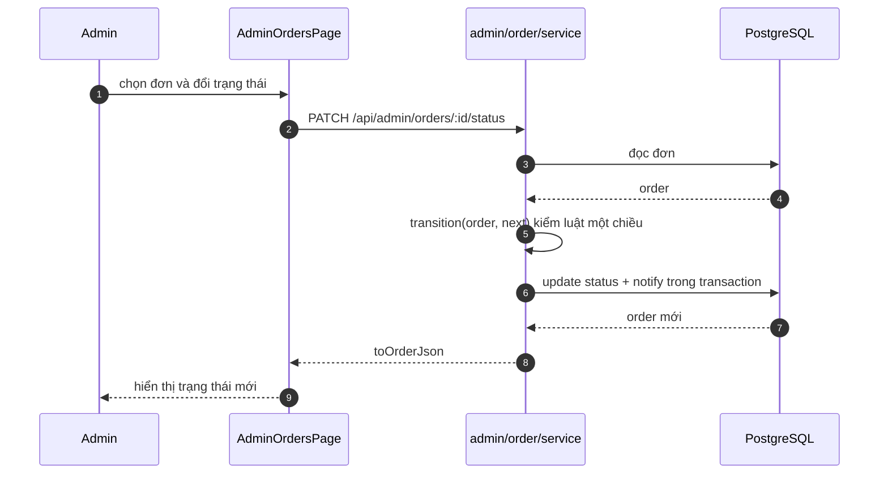

# Luồng quản trị

Trang này đi theo các việc admin làm được và các ràng buộc chặn sai sót. Quyền `ADMIN` được kiểm ở `server/src/admin/routes.ts:15` bằng `requireRole("ADMIN")` trên cả cây `/api/admin`.

## Trải nghiệm trên màn hình

- `/admin` là `AdminLayout`: menu trái 4 nhóm / 8 mục, không có khung chatbot.
- Các trang: dashboard, món ăn, danh mục, đơn hàng, khách hàng, khuyến mãi, báo cáo, tài liệu chatbot.
- Màu accent trong khu quản trị dùng class `orange-*`, không dùng `amber-*`.

## Sơ đồ tuần tự: admin xử lý đơn hàng



## Quản lý món và danh mục

Endpoint ở `server/src/admin/menu/routes.ts`. Admin thêm/sửa/xóa món, đổi `available`, tải ảnh lên `POST /api/admin/uploads/image` (JPG/PNG/WEBP, ≤ 2 MB, kiểm bằng chữ ký đầu file) hoặc dán URL ngoài.

Ảnh lưu ở `UPLOAD_DIR` (volume `uploads`) và phục vụ tại `/api/uploads/**`. Endpoint trả URL tuyệt đối.

Dữ liệu ảnh seed dùng file local dưới `client/public/images/foods/`. Đổi định dạng phải sửa `server/src/db/seed.ts` và chạy `UPDATE` cho DB cũ.

## Duyệt và sửa đơn

Xem [Đặt món và thanh toán](Luong-dat-mon) cho luật trạng thái. Admin có thêm:

- `adminUpdateStatus(id, status)` (`server/src/admin/order/service.ts:43-70`): chuyển trạng thái một chiều và gửi thông báo theo trạng thái.
- `adminUpdateOrder` (`service.ts:145-264`): áp `paid` **trước** khi đổi trạng thái để guard QR thấy trạng thái thanh toán mới.
- `adminDeleteOrder` (`service.ts:265-276`): xóa trong transaction.

### Code: khóa đơn đã chốt và xóa an toàn

Tọa độ: `server/src/admin/order/service.ts:145-152` và `:265-276`.

Vào: `id` của đơn và request sửa/xóa. Ra: lỗi 400 nếu đơn đã COMPLETED/CANCELLED, hoặc xóa thành công.

```ts
// Khoa hoan toan don da chot: khong sua duoc ca thong tin giao hang.
if (order.status === "COMPLETED" || order.status === "CANCELLED") {
  throw badRequest(
    `Don da ${order.status === "COMPLETED" ? "hoan thanh" : "huy"} nen khong sua duoc nua`,
  );
}

// Xoa trong mot transaction de khong con du lieu moc.
await db.transaction(async (tx) => {
  await tx.delete(notifications).where(eq(notifications.orderId, id));
  await tx.delete(paymentTransactions).where(eq(paymentTransactions.orderId, id));
  await tx.delete(orderItems).where(eq(orderItems.orderId, id));
  await tx.delete(orders).where(eq(orders.id, id));
});
```

Từng bước:
- `service.ts:148-152`: chặn sửa đơn đã chốt, kể cả thông tin giao hàng.
- `service.ts:265-276`: xóa thông báo (không có khóa ngoại nên xóa tay), giao dịch, dòng món, đơn.

Vì sao: `notifications.order_id` không có khóa ngoại nên phải xóa bằng tay; gom vào transaction để không còn dữ liệu móc.

## Quản trị toàn bộ API

### Code: guard ADMIN trên cả cây

Tọa độ: `server/src/admin/routes.ts:12-24`.

Vào: mọi request tới `/api/admin/**`. Ra: 401/403 nếu không phải ADMIN.

```ts
// Toan bo khu vuc quan tri yeu cau role ADMIN; route guard phia client chi la UX.
adminRouter.use(requireRole("ADMIN"));

adminRouter.use(menuAdminRouter);
adminRouter.use(orderAdminRouter);
adminRouter.use(customerAdminRouter);
adminRouter.use(promotionAdminRouter);
adminRouter.use(chatbotAdminRouter);
adminRouter.use(paymentAdminRouter);
adminRouter.use(reportAdminRouter);
adminRouter.use(uploadAdminRouter);
```

Vì sao: kiểm quyền ở middleware, không ở giao diện, nên sửa guard client không vượt được.

## Khách hàng

`/api/admin/customers/**`: xem danh sách, khóa/mở tài khoản, reset mật khẩu. Không sửa/khóa/xóa tài khoản quản trị. Xem `server/src/admin/customer/service.ts`.

## Khuyến mãi

Schema ở `server/src/admin/promotion/schema.ts`. Ràng buộc:

- Phạm vi `CATEGORY`/`FOOD` **phải** có `targetIds`; danh sách rỗng thì KM không khớp món nào, server trả 400 và client chặn trước khi gửi (`schema.ts:33-43`).

### Code: bắt buộc targetIds

Tọa độ: `server/src/admin/promotion/schema.ts:33-43`.

```ts
// Pham vi CATEGORY/FOOD chi ap cho id da chon; danh sach rong thi khong khop mon nao.
if (v.scope !== "GLOBAL" && (v.targetIds?.length ?? 0) === 0) {
  ctx.addIssue({
    code: "custom",
    message:
      v.scope === "CATEGORY"
        ? "Chon it nhat mot danh muc ap dung"
        : "Chon it nhat mot mon ap dung",
    path: ["targetIds"],
  });
}
```

- `usageLimit` bằng `0` nghĩa là **không giới hạn** (lưu `null`).
- `minOrderTotal` là hạn mức tổng đơn tối thiểu; engine `user/pricing` chỉ áp KM khi tổng đơn đạt mức (`minOrderReached`), nên trên thực đơn các KM có hạn mức không hiện giảm.

## Báo cáo

`/api/admin/reports/**`: doanh thu, top món, phân bố trạng thái. Dùng `parseBusinessRange` (`server/src/lib/businessTime.ts`) nên ngày theo lịch Việt. `topFoods` gom theo `foodId`, nên hai món trùng tên vẫn là hai món khác nhau.

Xuất Excel ở client từ dữ liệu API.

## Tài liệu chatbot

Trang `/admin/chatbot` chỉ có bảng tài liệu 4 cột: tiêu đề, nhóm, trạng thái, thao tác (Sửa/Xem/Cập nhật/Xóa). Nút "Tải lên tệp" mở modal kéo thả hoặc chọn tệp, upload ngay kèm progress bar (`onUploadProgress` của axios), nhận PDF/DOCX/TXT/MD tối đa 10 MB.

Không còn nút "Thêm thủ công", nút Embed riêng hay khối lịch sử hội thoại. Đã bỏ endpoint `/api/admin/chatbot/history`.

Cập nhật tài liệu (`ingest.ts`):

- Upload, parse, chunk không gọi AI, luôn chạy.
- Embed chunk chỉ khi `isConfigured()` = true.
- Nút "Cập nhật" chia lại chunk rồi embed lại.
- `GET /api/admin/chatbot/documents/stats` trả `totalDocuments`, `totalChunks`, `embeddedChunks`, `ready`, `failed`.

`ai_setting` chỉ lưu `max_suggestions` và `extra_rules` (`server/src/user/chatbot/service.ts:31-39`); model/embedding đọc từ biến môi trường.

### Code: upload và embed

Tọa độ: `server/src/admin/chatbot/routes.ts:69-86`.

```ts
// Tai len tep, parse + chunk ngay; embed neu provider dung duoc.
chatbotAdminRouter.post("/chatbot/documents/upload", documentUpload.single("file"), async (req, res) => {
  const file = req.file;
  if (!file || file.size === 0) throw badRequest("Tap rong");
  const title = typeof req.body?.title === "string" && req.body.title.trim() ? req.body.title.trim() : null;
  const category = typeof req.body?.category === "string" && req.body.category.trim() ? req.body.category.trim() : null;
  res.json(await ingestFile(file.originalname || "document.txt", file.buffer, title, category, null));
});

// Chia lai chunk va embed lai (nut "Cap nhat").
chatbotAdminRouter.post("/chatbot/documents/:id/reingest", async (req, res) => {
  res.json(await reingestDocument(idParam(req.params.id)));
});
```

Vì sao: upload + chunk không gọi AI nên luôn chạy; embed chỉ khi `isConfigured()`.

## Thống kê và seed

Seed bị bỏ qua nếu DB đã có user. Đổi dữ liệu mẫu thì database cũ vẫn giữ giá trị cũ; reset bằng `docker compose --profile prod down -v` rồi `up` lại.

Tiếp theo: [API](API) hoặc [Kiểm thử](Kiem-thu).
