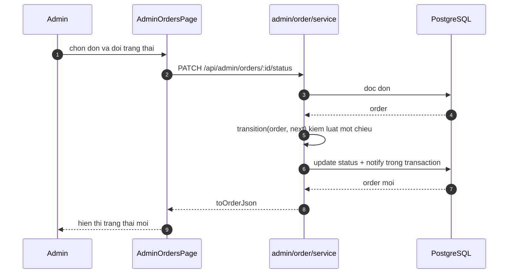

# Luong quan tri

Trang nay di theo cac viec admin lam duoc va cac rang buoc chan sai sot. Quyen `ADMIN` duoc kiem o `server/src/admin/routes.ts:15` bang `requireRole("ADMIN")` tren ca cay `/api/admin`.

## Trai nghiem tren man hinh

- `/admin` la `AdminLayout`: menu trai 4 nhom / 8 muc, khong co khung chatbot.
- Cac trang: dashboard, mon an, danh muc, don hang, khach hang, khuyen mai, bao cao, tai lieu chatbot.
- Mau accent trong khu quan tri dung class `orange-*`, khong dung `amber-*`.

## So do tuan tu: admin xu ly don hang



## Quan ly mon va danh muc

Endpoint o `server/src/admin/menu/routes.ts`. Admin them/sua/xoa mon, doi `available`, tai anh len `POST /api/admin/uploads/image` (JPG/PNG/WEBP, <= 2 MB, kiem bang chu ky dau file) hoac dan URL ngoai.

Anh luu o `UPLOAD_DIR` (volume `uploads`) va phuc vu tai `/api/uploads/**`. Endpoint tra URL tuyet doi.

Du lieu anh seed dung file local duoi `client/public/images/foods/`. Doi dinh dang phai sua `server/src/db/seed.ts` va chay `UPDATE` cho DB cu.

## Duyet va sua don

Xem [Dat mon va thanh toan](Luong-dat-mon) cho luat trang thai. Admin co them:

- `adminUpdateStatus(id, status)` (`server/src/admin/order/service.ts:43-70`): chuyen trang thai mot chieu va gui thong bao theo trang thai.
- `adminUpdateOrder` (`service.ts:145-264`): ap `paid` **truoc** khi doi trang thai de guard QR thay trang thai thanh toan moi.
- `adminDeleteOrder` (`service.ts:265-276`): xoa trong transaction.

### Code: khoa don da chot va xoa an toan

Toa do: `server/src/admin/order/service.ts:145-152` va `:265-276`.

Vao: `id` cua don va request sua/xoa. Ra: loi 400 neu don da COMPLETED/CANCELLED, hoac xoa thanh cong.

```ts
// Khoa hoan toan don da chot: khong sua duoc ca thong tin giao hang.
if (order.status === "COMPLETED" || order.status === "CANCELLED") {
  throw badRequest(
    `Don da ${order.status === "COMPLETED" ? "hoan thanh" : "huy"} nen khong sua duoc nua`,
  );
}

// Xoa trong mot transaction de khong con du lieu moc.
await db.transaction(async (tx) => {
  await tx.delete(notifications).where(eq(notifications.orderId, id));
  await tx.delete(paymentTransactions).where(eq(paymentTransactions.orderId, id));
  await tx.delete(orderItems).where(eq(orderItems.orderId, id));
  await tx.delete(orders).where(eq(orders.id, id));
});
```

Tung buoc:
- `service.ts:148-152`: chan sua don da chot, ke ca thong tin giao hang.
- `service.ts:265-276`: xoa thong bao (khong co khoa ngoai nen xoa tay), giao dich, dong mon, don.

Vi sao: `notifications.order_id` khong co khoa ngoai nen phai xoa bang tay; gom vao transaction de khong con du lieu moc.

## Quan tri toan bo API

### Code: guard ADMIN tren ca cay

Toa do: `server/src/admin/routes.ts:12-24`.

Vao: moi request toi `/api/admin/**`. Ra: 401/403 neu khong phai ADMIN.

```ts
// Toan bo khu vuc quan tri yeu cau role ADMIN; route guard phia client chi la UX.
adminRouter.use(requireRole("ADMIN"));

adminRouter.use(menuAdminRouter);
adminRouter.use(orderAdminRouter);
adminRouter.use(customerAdminRouter);
adminRouter.use(promotionAdminRouter);
adminRouter.use(chatbotAdminRouter);
adminRouter.use(paymentAdminRouter);
adminRouter.use(reportAdminRouter);
adminRouter.use(uploadAdminRouter);
```

Vi sao: kiem quyen o middleware, khong o giao dien, nen sua guard client khong vuot duoc.

## Khach hang

`/api/admin/customers/**`: xem danh sach, khoa/mo tai khoan, reset mat khau. Khong sua/khoa/xoa tai khoan quan tri. Xem `server/src/admin/customer/service.ts`.

## Khuyen mai

Schema o `server/src/admin/promotion/schema.ts`. Rang buoc:

- Pham vi `CATEGORY`/`FOOD` **phai** co `targetIds`; danh sach rong thi KM khong khop mon nao, server tra 400 va client chan truoc khi gui (`schema.ts:33-43`).

### Code: bat buoc targetIds

Toa do: `server/src/admin/promotion/schema.ts:33-43`.

```ts
// Pham vi CATEGORY/FOOD chi ap cho id da chon; danh sach rong thi khong khop mon nao.
if (v.scope !== "GLOBAL" && (v.targetIds?.length ?? 0) === 0) {
  ctx.addIssue({
    code: "custom",
    message:
      v.scope === "CATEGORY"
        ? "Chon it nhat mot danh muc ap dung"
        : "Chon it nhat mot mon ap dung",
    path: ["targetIds"],
  });
}
```

- `usageLimit` bang `0` nghia la **khong gioi han** (luu `null`).
- `minOrderTotal` la han muc tong don toi thieu; engine `user/pricing` chi ap KM khi tong don dat muc (`minOrderReached`), nen tren thuc don cac KM co han muc khong hien giam.

## Bao cao

`/api/admin/reports/**`: doanh thu, top mon, phan bo trang thai. Dung `parseBusinessRange` (`server/src/lib/businessTime.ts`) nen ngay theo lich Viet. `topFoods` gom theo `foodId`, nen hai mon trung ten van la hai mon khac nhau.

Xuat Excel o client tu du lieu API.

## Tai lieu chatbot

Trang `/admin/chatbot` chi co bang tai lieu 4 cot: tieu de, nhom, trang thai, thao tac (Sua/Xem/Cap nhat/Xoa). Nut "Tai len tep" mo modal keo tha hoac chon tep, upload ngay kem progress bar (`onUploadProgress` cua axios), nhan PDF/DOCX/TXT/MD toi da 10 MB.

Khong con nut "Them thu cong", nut Embed rieng hay khoi lich su hoi thoai. Da bo endpoint `/api/admin/chatbot/history`.

Cap nhat tai lieu (`ingest.ts`):

- Upload, parse, chunk khong goi AI, luon chay.
- Embed chunk chi khi `isConfigured()` = true.
- Nut "Cap nhat" chia lai chunk roi embed lai.
- `GET /api/admin/chatbot/documents/stats` tra `totalDocuments`, `totalChunks`, `embeddedChunks`, `ready`, `failed`.

`ai_setting` chi luu `max_suggestions` va `extra_rules` (`server/src/user/chatbot/service.ts:31-39`); model/embedding doc tu bien moi truong.

### Code: upload va embed

Toa do: `server/src/admin/chatbot/routes.ts:69-86`.

```ts
// Tai len tep, parse + chunk ngay; embed neu provider dung duoc.
chatbotAdminRouter.post("/chatbot/documents/upload", documentUpload.single("file"), async (req, res) => {
  const file = req.file;
  if (!file || file.size === 0) throw badRequest("Tap rong");
  const title = typeof req.body?.title === "string" && req.body.title.trim() ? req.body.title.trim() : null;
  const category = typeof req.body?.category === "string" && req.body.category.trim() ? req.body.category.trim() : null;
  res.json(await ingestFile(file.originalname || "document.txt", file.buffer, title, category, null));
});

// Chia lai chunk va embed lai (nut "Cap nhat").
chatbotAdminRouter.post("/chatbot/documents/:id/reingest", async (req, res) => {
  res.json(await reingestDocument(idParam(req.params.id)));
});
```

Vi sao: upload + chunk khong goi AI nen luon chay; embed chi khi `isConfigured()`.

## Thong ke va seed

Seed bi bo qua neu DB da co user. Doi du lieu mau thi database cu van giu gia tri cu; reset bang `docker compose --profile prod down -v` roi `up` lai.

Tiep theo: [API](API) hoac [Kiem thu](Kiem-thu).
