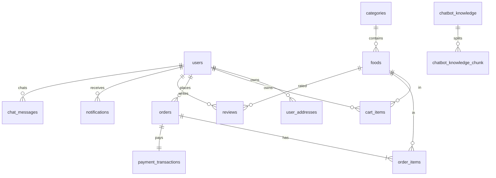

# Mô hình dữ liệu

Toàn bộ bảng khai báo ở `server/src/db/schema.ts`. Migration SQL nằm trong `server/drizzle/`, không có Flyway. Trang này ghi lại bảng nào dùng cho việc gì, cột nào quan trọng và ràng buộc nào là cố ý.

## Quan hệ

## Enum

| Enum | Giá trị | Dùng ở |
|---|---|---|
| `Role` | `CUSTOMER`, `ADMIN` | `users.role` |
| `OrderStatus` | `PENDING`, `CONFIRMED`, `PREPARING`, `COMPLETED`, `CANCELLED` | `orders.status` |
| `PaymentStatus` | `UNPAID`, `PAID` | `orders.payment_status` |
| `PaymentTransactionStatus` | `PENDING`, `PAID` | `payment_transactions.status` |
| `MessageSender` | `USER`, `BOT` | `chat_messages.sender` |
| `DiscountType` | `PERCENT`, `FIXED` | `promotions.discount_type` |
| `PromotionScope` | `GLOBAL`, `CATEGORY`, `FOOD` | `promotions.scope` |

Khai báo ở `server/src/db/schema.ts:18-43`. Nhãn hiển thị tiếng Việt không nằm trong database mà ở `ORDER_STATUS_LABEL` (`server/src/user/order/transitions.ts:4-10`).

## Người dùng

### `users`
`server/src/db/schema.ts:45-55`

| Cột | Kiểu | Ghi chú |
|---|---|---|
| `id` | serial | khoá chính |
| `email` | varchar(255) | duy nhất, cũng là subject của JWT |
| `password` | text | hash bcrypt, không bao giờ trả về client |
| `full_name`, `phone`, `address` | varchar/text | hồ sơ cơ bản |
| `role` | `Role` | mặc định `CUSTOMER` |
| `active` | boolean | `false` là tài khoản bị khoá |
| `created_at` | timestamp | |

`active` được kiểm ở mỗi request (`server/src/middleware/auth.ts:21-26`), nên khoá tài khoản có hiệu lực ngay, không chờ token hết hạn.

### `user_addresses`
`server/src/db/schema.ts:57-68`

Sổ địa chỉ của khách. `user_id` xoá theo người dùng (`onDelete: cascade`). `is_default` chỉ là nhãn hiển thị, không có ràng buộc duy nhất ở database.

## Thực đơn

### `categories`
`server/src/db/schema.ts:70-76`

| Cột | Ghi chú |
|---|---|
| `name` | duy nhất, là tên nhóm hiển thị |
| `slug` | dùng để nhận diện nhóm đồ uống/tráng miệng trong chatbot (`do-uong`, `trang-mieng`) |
| `image_url`, `description` | ảnh và mô tả nhóm |

### `foods`
`server/src/db/schema.ts:78-91`

| Cột | Kiểu | Ghi chú |
|---|---|---|
| `price` | numeric(12,2) | lưu dạng chuỗi trong JS, đổi sang số ở serializer |
| `category_id` | integer | không cascade: xoá danh mục bị chặn nếu còn món |
| `serving_size` | integer | số người món phục vụ, dùng cho bộ lọc khẩu phần |
| `spicy_level` | integer | 0 đến 3; `0` là không cay |
| `dietary_tags` | text | danh sách phân tách dấu phẩy, ví dụ `chay,gluten-free` |
| `allergens` | text | danh sách phân tách dấu phẩy |
| `available` | boolean | `false` là ngừng phục vụ, không thêm được vào giỏ |

Giá là `numeric` chứ không phải `float`, nên không có sai số khi cộng tiền. Mọi chỗ tính tiền đều đổi sang số bằng `Number()`.

## Giỏ hàng

### `cart_items`
`server/src/db/schema.ts:93-108`

| Cột | Ghi chú |
|---|---|
| `user_id` | xoá theo người dùng |
| `food_id` | xoá theo món |
| `quantity` | mặc định 1 |

Có `unique(user_id, food_id)` nhờ `uniqueIndex` ở dòng 105-107. Ràng buộc này là điều kiện để `addToCart` dùng `onConflictDoUpdate` cộng dồn số lượng trong một câu lệnh thay vì đọc rồi ghi (`server/src/user/cart/service.ts:36-44`).

## Đơn hàng

### `orders`
`server/src/db/schema.ts:110-127`

| Cột | Ghi chú |
|---|---|
| `user_id` | không cascade: xoá người dùng bị chặn khi còn đơn |
| `status` | mặc định `PENDING` |
| `payment_method` | `COD` hoặc `QR`, kiểm bằng zod ở `server/src/user/order/schema.ts:3` |
| `payment_status` | mặc định `UNPAID` |
| `total` | tổng khách phải trả, đã trừ khuyến mãi |
| `discount_total` | tổng tiền giảm |
| `receiver_name`, `phone`, `address`, `note` | thông tin giao hàng |

`total` và `discount_total` do server tính, không nhận từ client. Xem [Đặt món và thanh toán](Luong-dat-mon).

### `order_items`
`server/src/db/schema.ts:129-140`

| Cột | Ghi chú |
|---|---|
| `order_id` | xoá theo đơn |
| `food_id` | `onDelete: set null`: xoá món vẫn giữ lịch sử đơn |
| `price` | giá tại lúc mua |
| `discount_amount` | tiền giảm của cả dòng, không phải của một đơn vị |

Vì `food_id` có thể null và `price` là ảnh chụp, đơn cũ vẫn hiển thị đúng dù món đổi giá hoặc bị xoá.

### `payment_transactions`
`server/src/db/schema.ts:142-153`

Mỗi đơn có đúng một dòng (`order_id` unique). `amount` cập nhật lại khi admin sửa món. `paid_at` null khi chưa trả.

### `reviews`
`server/src/db/schema.ts:155-166`

| Cột | Ghi chú |
|---|---|
| `rating` | số sao |
| `comment` | tối đa 1000 ký tự |

**Không có unique index trên `(user_id, food_id)`.** Ràng buộc "mỗi người một đánh giá cho mỗi món" được chặn bằng code (`server/src/user/review/service.ts:71-80`), vì vậy đừng thêm index này mà không sửa luồng báo lỗi.

### `notifications`
`server/src/db/schema.ts:168-177`

`order_id` **không có khoá ngoại**, nên xoá đơn phải xoá thông báo bằng tay (`server/src/admin/order/service.ts:265-276`). Đây là lý do `adminDeleteOrder` chạy trong transaction.

## Khuyến mãi

### `promotions`
`server/src/db/schema.ts:179-200`

| Cột | Ghi chú |
|---|---|
| `discount_type`, `discount_value` | phần trăm hoặc số tiền cố định |
| `max_discount` | trần giảm cho loại phần trăm |
| `min_order_total` | tổng đơn tối thiểu mới áp |
| `scope` + `target_ids` | `GLOBAL` bỏ qua `target_ids`; `CATEGORY`/`FOOD` bắt buộc có |
| `starts_at`, `ends_at` | khoảng hiệu lực |
| `days_of_week`, `start_time`, `end_time` | khung giờ và thứ trong tuần |
| `usage_limit` | null là không giới hạn |
| `used_count` | số lượt đã dùng, tăng trong transaction tạo đơn |
| `priority` | dùng khi nhiều khuyến mãi cùng khớp |

`target_ids` là mảng số nguyên, mặc định `[]`. Kiểm tra "phải có ít nhất một id" nằm ở zod, không ở database (`server/src/admin/promotion/schema.ts:33-43`).

## Chatbot

### `chat_messages`
`server/src/db/schema.ts:218-226`

| Cột | Ghi chú |
|---|---|
| `user_id` | xoá theo người dùng |
| `session_id` | varchar(100), gom tin thành phiên |
| `sender` | `USER` hoặc `BOT` |
| `content` | cắt còn 4000 ký tự trước khi lưu |
| `payload` | jsonb, ảnh chụp thẻ món và cờ của tin bot |

`payload` là lý do mở lại phiên vẫn thấy thẻ món (`server/src/db/schema.ts:202-216` định nghĩa kiểu). Giá trong payload là giá lúc trả lời, không phải giá hiện tại.

### `chatbot_knowledge`
`server/src/db/schema.ts:228-241`

Tài liệu tri thức của quán: tiêu đề, nhóm, nội dung gốc, tên file, trạng thái `READY` và lỗi embed nếu có. `enabled` quyết định tài liệu có được tìm hay không.

### `chatbot_knowledge_chunk`
`server/src/db/schema.ts:245-257`

| Cột | Ghi chú |
|---|---|
| `document_id` | trỏ tới tài liệu, **không khai báo khoá ngoại** |
| `chunk_index` | thứ tự đoạn trong tài liệu |
| `content` | đoạn văn, khoảng 600 ký tự |
| `embedding` | `vector(768)` |
| `embedding_model`, `embedded_at` | model đã dùng và thời điểm |

Có index HNSW `vector_cosine_ops` ở dòng 254-257. Vì không có khoá ngoại, xoá tài liệu phải xoá chunk trước; việc này nằm trong `server/src/user/chatbot/ingest.ts:215-227`.

### `ai_setting`
`server/src/db/schema.ts:259-262`

Bảng khoá-giá trị hai cột. Trang quản trị chỉ dùng hai khoá: `max_suggestions` và `extra_rules` (`server/src/user/chatbot/service.ts:31-39`).

## Bảng nào được ghi ở đâu

| Bảng | Chỉ ghi từ |
|---|---|
| `users`, `user_addresses` | auth, profile, admin customer |
| `categories`, `foods` | admin menu, seed |
| `cart_items` | `user/cart/service.ts` |
| `orders`, `order_items` | `createOrder`, `adminCreateOrder`, `adminUpdateOrder` |
| `payment_transactions` | `createOrder`, `updatePayment`, `adminUpdateOrder` |
| `reviews` | `user/review/service.ts` |
| `notifications` | `notify` trong `user/order/service.ts`, job hết hạn, admin order |
| `promotions` | admin promotion, `markUsed`/`unmarkUsed` |
| `chat_messages` | `user/chatbot/service.ts` |
| `chatbot_knowledge`, `chatbot_knowledge_chunk`, `ai_setting` | admin chatbot, `chatbot/ingest.ts` |

Quy tắc chung: mỗi bảng chỉ có một lớp service ghi, trừ `notifications` vì nó phát sinh từ nhiều luồng. Nếu cần ghi ở nơi mới, gọi `notify` thay vì tự `insert`.

Tiếp theo: [Kiến trúc](Kien-truc) để biết các lớp đọc ghi này nằm ở đâu.
